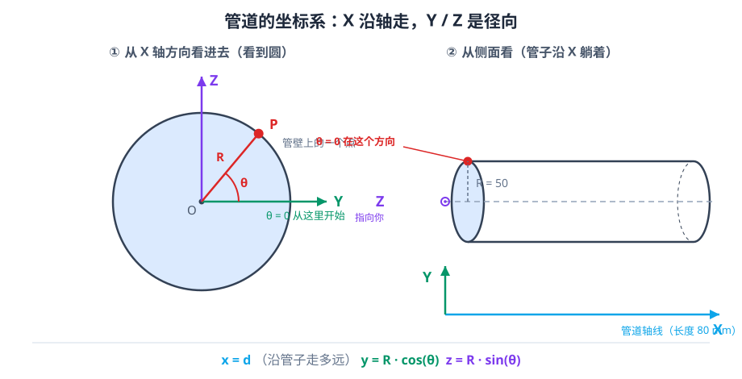
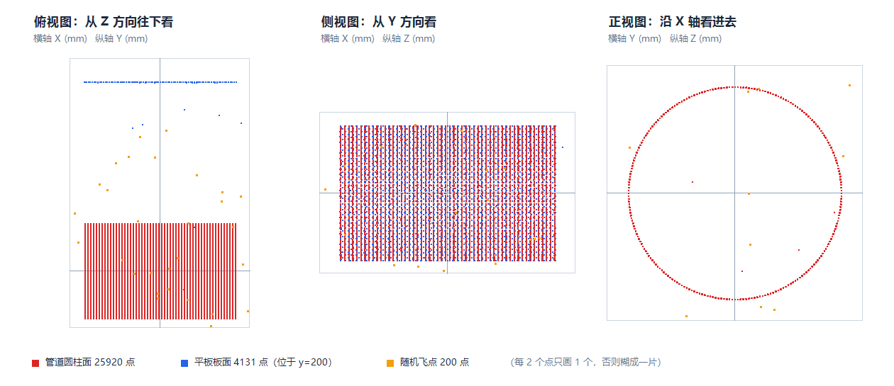

# 01 原始点云数据

> 对应代码：`src/data/scene_presets.h/.cpp`、`src/data/generate_scene.cpp`、`src/data/inspect_cloud.cpp`
> 对应文件：`data/scene_original.pcd`（30251 点，363184 字节）
>
> **这篇文档要解决一个问题：为什么全项目只认这一份数据？**

---

## 1. 为什么先讲数据

学习点云算法，最常见的失败模式是：

> 「我把代码跑通了，输出文件也有了，但我不知道结果对不对。」

**因为没有一个"标准答案"可以对照。**

所以本项目的第一件事不是写算法，而是**造一份"我们知道它长什么样"的数据**。

- 管道半径 = 50mm → RANSAC 圆柱应该拟合出半径 50
- 平板在 y = 200 → RANSAC 平面应该找到法向 (0,-1,0)
- 飞点只有 200 个 → 统计滤波应该删掉大约 200 个

**有了这些"已知答案"，每一个算法的输出都能被验证。**
这就是「合成数据」在学习阶段最大的价值。

---

## 2. 点云到底是什么

### 2.1 三个坐标

一个点是：

```cpp
pcl::PointXYZ p(15.2f, 48.7f, -3.1f);
```

意思是：**距原点 x 方向 15.2mm、y 方向 48.7mm、z 方向 -3.1mm 的一个位置**。

**PCL 不关心单位。** 它只知道这是三个数。
本项目约定 **全部单位是毫米（mm）**（详见 [07_PCL点云数据结构.md](07_PCL点云数据结构.md) 第 9 节）。

**坐标系约定**（见 `src/data/scene_presets.h` 头部注释）：

| 轴 | 含义 |
|---|---|
| **X** | **管道轴线方向**（管子沿 X 躺着） |
| Y | 径向，**θ=0 的位置** |
| Z | 径向，垂直于 X 和 Y |

**管道表面上的一个点**（半径 R，角度 θ，轴位置 d）：

```
x = d
y = R·cos(θ)
z = R·sin(θ)
```

**这个公式贯穿全项目的每一处几何计算** —— 记住它。



左图是**沿着 X 轴看进去**（就像站在管子的一头往里看），所以你看到的是一个圆：
圆心 O 在管子轴线上，半径 R=50mm，θ 从 +Y 方向开始逆时针量。
红点 P 就是管道表面上的一个点，它离轴心 50mm，与 +Y 夹角 θ。

右图是**从侧面看**：管子沿 X 方向躺在那里，Z 轴朝你自己。
θ=0 的那条线（红点）始终在 +Y 方向 —— 这就是为什么代码里算 `y = R·cos θ`、`z = R·sin θ` 而不是反过来。

### 2.2 点数：30251

**菜单 2 打印的第一行就是点数。**

**为什么是 30251 这么个奇怪的数？** 因为它是三部分加起来：

```
管道表面   25920
平板板面    4131
随机飞点     200
──────────────
合计       30251
```

**注意：这三个数没有一个是你随手定的** —— 每个都由参数算出来：

**管道 25920**：

```
环向：ntheta = 240 个（每 1.5° 一个）
轴向：来自轴向位置列表（坡口区按 bevelStep、其余按 axialStep 生成）
25920 = 240 × 108
```

**平板 4131**：

```
plateSizeX = 160, plateSizeZ = 100, plateStep = 2
标称点数 = (160/2 + 1) × (100/2 + 1) = 81 × 51 = 4131  ✓
```

**完全对上。** 这个验算是理解"参数如何决定点数"的最直接方式。

### 2.2.1 这三部分点云长什么样（实拍三视图）

上面那些数字是抽象的。把 `data/scene_original.pcd` 真的读出来，用三个方向各拍一张"照片"：



**怎么看这三张图：**

| 面板 | 看到什么 | 说明了什么 |
|---|---|---|
| **俯视**（从 Z 往下看） | 一块竖着的红色长条 + 顶部一条蓝色细线 | 红色长条 = 管道（沿 X 躺了 160mm，宽 100mm）；蓝色线 = 平板在 y=200 处，离管道很远 |
| **侧视**（从 Y 方向看） | 同样的红色长条，上面有条纹 | 条纹就是环向采样（每 1.5° 一条线）；管道在 X 方向确实是直的 |
| **正视**（沿 X 轴看进去） | **一个完整的圆** | 这就是你上一节看到的那个坐标公式 `y=R·cos θ, z=R·sin θ` 画出来的结果 |

**三个关键观察：**
1. **管道和平板在空间上是分开的** —— 俯视图里红色（管道）和蓝色（平板）之间隔着大片空白，所以欧氏聚类能轻松把它们分成两簇。
2. **正视图是一个完美的圆** —— 因为合成数据没有遮挡、没有噪声（噪声只有 0.05mm，在 120mm 的圆上看不出来）。
3. **橙色小方块是飞点** —— 它们散布在整个 ±180mm 的盒子里。注意看侧视图和正视图，橙色点都落在管道**外面**，这就是统计滤波要清除的目标。

> 这张图是直接用 PowerShell 读 `scene_original.pcd` 的二进制数据、按三视图投影画出来的，
> **不是 PCLVisualizer 截图**。所以它就是文件里那 30251 个坐标的真实样子。

### 2.3 采样密度：点与点隔多远

**密度 = 单位面积上多少个点。**

**更直观的说法是"点间距"：相邻两个点隔多少毫米。**

**菜单 2 打印**：

```
  平均点间距     : 1.470
```

**它是怎么算出来的？** 见 `src/data/inspect_cloud.cpp` 的 `estimateMeanSpacing()`：

1. 随机抽 2000 个点（`std::mt19937(12345)` 固定种子）
2. 对每个点，用 KD-Tree 找**最近的另一个点**
3. 算距离，取平均

**为什么不用全部 30251 个点？** 因为找最近邻要建树（O(n log n)），
2000 个点已经足够稳定，快 15 倍。

**1.470mm 这个数有什么用？**

它是所有"尺度参数"的基准：

| 参数 | 该取多少 | 理由 |
|---|---|---|
| 体素边长 `leaf` | **1~3mm** | 太小 ≈ 点数不降（每个体素 1 点）；太大 ≈ 管壁变薄片 |
| SOR 的 `meanK` | **20** | 邻域要覆盖 3~4 圈点 |
| RANSAC 距离阈值 | **0.5~2mm** | 太小 ≈ 内点不足；太大 ≈ 把弯曲管壁也吸进来 |
| 聚类容差 `tolerance` | **2~3mm** | 必须 > 2 倍点间距，否则同一条管壁会碎成 20 块 |

**记住这个 1.47** —— 后面所有参数文档都在跟它对照。

### 2.4 噪声：坐标里的小抖动

**理想情况下**，管道表面的点在数学上是一个完美圆柱。

**但我们给每个点的坐标加了随机扰动**：

```cpp
// src/data/generate_scene.cpp:37-48（简化）
p.x += opt.noiseSigma * gauss(rng);
p.y += opt.noiseSigma * gauss(rng);
p.z += opt.noiseSigma * gauss(rng);
```

**默认 `noiseSigma = 0.05`（mm）**，也就是 **50 微米**。

**这点扰动看起来可以忽略（50μm 对 50000μm 的半径），但它有两个重要作用：**

1. **让数据"像真的"** —— 真实激光扫描绝对不存在完美几何
2. **让算法有"抖动"** —— 如果数据完美，RANSAC 一次就能找到平面，
   体素降采样也不会出现"同一个体素里点数不同"的现象

**注意噪声和离群点不是一回事**：

| | 噪声 | 离群点（飞点） |
|---|---|---|
| 幅度 | 0.05mm | 最远 180mm |
| 数量 | 每个点都有 | 只有 200 个 |
| 来源 | 传感器精度 | 传感器错误 / 反光 / 杂散光 |
| 该不该删 | **不删**（删了就失真） | **该删** |
| 谁处理它 | 不处理 | SOR / ROR |

**这个区分是理解滤波文档的前提。** 见 [09_统计滤波与半径滤波.md](09_统计滤波与半径滤波.md)。

---

## 3. PCD 文件长什么样

**打开 `data/scene_original.pcd` 的前 11 行**（PowerShell）：

```powershell
Get-Content .\data\scene_original.pcd -TotalCount 11
```

**输出**：

```
# .PCD v0.7 - Point Cloud Data file format
VERSION 0.7
FIELDS x y z
SIZE 4 4 4
TYPE F F F
COUNT 1 1 1
WIDTH 30251
HEIGHT 1
VIEWPOINT 0 0 0 1 0 0 0
POINTS 30251
DATA binary
```

**这就是整个文件结构**：11 行文本头 + 一大段二进制数据。

**逐行含义**（详细版在 [07_PCL点云数据结构.md](07_PCL点云数据结构.md) 第 6 节）：

| 行 | 含义 | 本项目的值 |
|---|---|---|
| `FIELDS x y z` | 有哪些字段 | 只有坐标，没有强度/颜色 |
| `SIZE 4 4 4` | 每个字段几字节 | float = 4 字节 |
| `TYPE F F F` | 数据类型 | `F` = float |
| `WIDTH 30251` | 宽度 | = 点数（无序点云） |
| `HEIGHT 1` | 高度 | 无序点云固定 1 |
| `POINTS 30251` | 总点数 | = WIDTH × HEIGHT |
| `DATA binary` | 数据区格式 | 二进制（快、小、不可读） |

**验算文件大小**：

```
363184 字节（文件总大小）
      − 172 字节（11 行头部，估算）
= 363012 字节
363012 ÷ 12（每点 x/y/z 各 4 字节）= 30251 点  ✓
```

**这个简单的除法能验证"文件没坏、点数对得上"。**
以后你拿到任何一份 PCD，都可以用这招快速检查。

---

## 4. 合成点云与真实激光扫描的区别

**这是整篇文档最重要的一节。**

**因为你将来一定会拿真实数据来跑，然后发现结果一塌糊涂。**
**那时你需要知道"为什么"。**

### 4.1 对比表

| 特征 | 本项目的合成数据 | 真实线激光扫描 |
|---|---|---|
| **几何** | 数学上的完美圆柱 + 高斯扰动 | 真实管道有椭圆度、壁厚不均、圆度误差 |
| **噪声** | 0.05mm，各向同性高斯 | 沿视线方向噪声大、切向小；且**随距离和入射角变化** |
| **密度** | 均匀（每 1.5° 一个点） | **严重不均**：正对处密，斜射处疏 |
| **覆盖** | `viewAngleDeg = 360`（整圈） | **单视角只能看到一半**，背面是遮挡阴影（盲区） |
| **遮挡** | 完全没有 | 焊缝余高会挡住后面的坡口；管道自己挡自己 |
| **飞点** | 均匀分布在一个立方体里 | **成簇出现**（反光、飞溅、其他物体），且集中在特定方向 |
| **坐标系** | 就是工件坐标系 | **传感器坐标系**，还需要标定 + 手眼变换才能到工件坐标系 |
| **单位** | 确定是 mm | **不确定**（可能是 m，取决于设备驱动） |
| **隐藏结构** | 无 | 有：管道内壁、法兰、支架、地面 |

### 4.2 最要命的三条

**① 密度不均 → 所有"距离阈值"参数都会失效**

**合成数据点间距处处是 1.47mm，所以 `tolerance = 3.0` 对所有地方都合适。**

**真实数据的点间距从 0.5mm（正对）到 5mm（斜射）变化** ——
同一组参数，近处完美，远处碎成几百块。

**应对方法**：分区处理，或者用"自适应阈值"（按局部密度定）。

**② 单视角 → 只有一半数据**

**合成数据能看到整圈管壁，所以"圆柱拟合"很稳。**

**真实扫描只有朝向传感器的那一面**（约 120°~180°）。
**拟合圆柱时只有半圈点，半径会偏、圆心会飘。**

**应对方法**：多视角拼接、或者用"半圆约束"的拟合。

**③ 飞点成簇 → 统计滤波会失效**

**合成数据的 200 个飞点是独立均匀分布的** —— 每个飞点周围空荡荡，
SOR/ROR 一删一个准。

**真实飞点是"一簇一簇"的** —— 比如一片反光的区域产生 500 个点。
**这些点彼此邻近**，所以 ROR 认为"它们有邻居，是正常点"，删不掉。

**应对方法**：先按"强度"或"距离范围"粗筛，再用滤波。

### 4.3 那为什么还要用合成数据

**因为学习算法时，你需要"控制变量"。**

| 你想学 | 合成数据的优势 |
|---|---|
| 体素降采样怎么影响点数 | 密度均匀，理论公式能精确验证 |
| RANSAC 迭代次数够不够 | 内点比例是已知的（13.65%），能算理论值 |
| 聚类容差取多少 | 点间距是常数，临界值能算出来（1.99mm） |
| 滤波删了多少真点 | 有"真值标签"，能算准确率 |

**真实数据里，这些全都做不到** —— 因为你自己也不知道"正确答案"是什么。

**所以正确的路线是**：先用合成数据把算法原理吃透，再上真实数据。

---

## 5. 固定随机种子：为什么必须是同一个数

### 5.1 代码里的种子

```cpp
// src/data/generate_scene.cpp:93-96
std::mt19937 rng(p.seed);                      // 种子
std::normal_distribution<float> gauss(0.0f, 1.0f);   // 高斯
std::uniform_real_distribution<float> uni(-1.0f, 1.0f); // 均匀
```

**`SceneParams::seed` 默认 `20250101`。**

**`std::mt19937` 是"伪随机数生成器"** —— 它输出的数字看起来随机，
但**给定同一个种子，输出的序列完全一样**。

### 5.2 为什么这很重要

**如果你每次运行生成的点云都不同：**

- 昨天跑 RANSAC 得到 2213 个内点，今天变成 2280 → **无法判断是代码改坏了还是数据变了**
- 文档里写的"30251 点"和你的实际不符 → **对不上**
- 别人（或未来的你）复现不了你的实验

**固定种子后：**

```
种子 20250101 + 预设 pipe_plate → 永远生成 30251 点，MD5 = 14122CBEBAA4DC2D9CEB5D44EAD5AA9F
```

**这就是"可复现性"**。**它是工程和科研的基本要求。**

### 5.3 什么情况下"固定种子也不一定一致"

**两个坑：**

**① 换标准库实现**

`std::normal_distribution` 的**具体算法由标准库决定**，标准没有规定。
MSVC、GCC、Clang 的实现**不一样**。

**所以：同一份代码在 VS2026 编译和在 Linux 上编译，生成的点云不同。**

**（本项目只考虑 MSVC，所以不受影响。但要知道这个坑存在。）**

**② 换个编译器版本**

MSVC 升级时可能改 `normal_distribution` 的实现 → 数字变了。

**本项目环境已验证**：VS2026 和 VS2022 生成的场景**完全一致**
（因为用的是同一套 MSVC 标准库实现）。

**但如果你换了 VS 版本发现点数差了几百个，别惊慌** ——
这不是 bug，是随机序列变了。**统计特性（点数、范围）不变。**

---

## 6. 三部分点云各测什么

### 6.1 管道表面（25920 点）：测"曲面拟合"和"降采样"

**用来学**：

- **体素降采样**：圆柱是曲面，降采样后应该还是圆柱（形状不变、点数减少）
- **RANSAC 圆柱拟合**（后续扩展）：应该拟合出 R = 50.00、轴线 = X 轴
- **法向估计**：每个点的法向应该沿径向

**验证点**：

- 降采样后 `leaf=2.0` → 17847 点（保留 59%）
- 平均点间距从 1.470 变成约 2.0

**为什么管道要"薄壁"？**

因为 `pipeThickness = 12` 意味着**壁厚 12mm**。
这个参数目前**没有生成内壁点**（`enableInner` 默认关）—— 代码里留了位置。
**真实管道内壁在扫描时通常看不到**（除非从管口伸进去），所以默认不生成是对的。

### 6.2 平板（4131 点）：测"平面拟合"

**为什么需要平板？**

因为**平板是完美的平面** —— RANSAC 平面拟合的"标准答案"。

**验证点**：

```
法向 = (0, -1, 0)   （或 (0, 1, 0)，RANSAC 不保证朝向）
d    = 200          （平面方程 0·x - 1·y + 0·z + 200 = 0  →  y = 200）
内点 = 4131         （平板全部点数）
```

**菜单 9 实测（迭代 5000）**：

```
内点数量          : 4131
平面方程          : -0.0000·x + -1.0000·y + 0.0000·z + 199.999451 = 0
法向量            : (-0.0000, -1.0000, 0.0000)
```

**完美对上。** 这就是"已知答案"的价值。

**⚠️ 但注意一个坑**：迭代 1000 次时，RANSAC **找不到平板**，
而是找到管壁上一条"近似平面"（2213 个点，法向 (0, 0.385, 0.923)）。

**原因**：平板只占 13.65% 的点，三点全落在平板上的概率只有 0.26%，
1000 次迭代里一次都没抽中的概率约 7.4%。

**这是本项目最好的教学案例之一** —— 详见 [12_RANSAC平面分割.md](12_RANSAC平面分割.md)。

### 6.3 飞点（200 个）：测"离群点滤波"

**飞点 = 均匀撒在 ±180mm 立方体内的随机点。**

**为什么要 ±180 这么大？** 因为要**离管道和平面足够远**（`outlierBoxHalf = 180`）：
管道半径 50，平板在 y=200，飞点到最近点云的距离通常 > 50mm。

**这样设计的好处**：任何合理的滤波参数都能把它们删干净，
从而验证"滤波算法确实在工作"。

**验证点**：

| 算法 | 参数 | 删除数 | 是否删净 200 个飞点 |
|---|---|---|---|
| SOR | meanK=20, std=1.0 | **196** | 差 4 个 |
| ROR | r=3.0, n=6 | **459** | 删多了（含真点） |

**SOR 删 196 而不是 200，这 4 个是什么？**

**是"碰巧落在统计范围之外的真实点"** —— 边界点、噪声大的点。
**真实数据里，"删除数 ≠ 飞点数"恰恰是正常现象。**
（详见 [09_统计滤波与半径滤波.md](09_统计滤波与半径滤波.md)）

### 6.4 三部分的空间关系图

```
       y
       ↑
  200  ●─────────────────●   平板（4131 点，y=200 的平面）
       │                 │
       │                 │
   50  ╭───────╮         │   管道（25920 点，R=50，轴沿 X）
       │       │         │
    0  ●       ●         │   ← 原点在管道轴线上
       │       │         │
  -50  ╰───────╯         │
       │                 │
  -180 ┊ · · · · · · · · ┊   ← 飞点在 ±180 的立方体里随机分布
       └─────────────────→ x
      -180               180
```

**关键设计**：

- 管道中心在原点，轴沿 X
- 平板在 y=200，距离管壁 150mm（足够远，欧氏聚类能分开）
- 飞点散布在 ±180 的大盒子里，远离两者

**这就是"欧氏聚类能分出 2 簇"的空间基础。**
如果平板贴着管壁（间距 < tolerance），就会被连成一簇。

---

## 7. 怎么生成、读取、检查

### 7.1 生成（两种方式）

**方式 1：菜单**（推荐，不用改代码）

```
1  生成合成场景（选择预设）
    → 输入 1（默认场景 pipe_plate）
```

**输出**：

```
================ 石油管道环焊缝点云练习台 ================
  已生成场景                : 管道 + 平板 + 飞点（默认，原始场景）
  管道点                    : 25920
  平板点                    : 4131
  飞点（离群点）            : 200
  总点数                    : 30251
  X 范围                    : X [-179.48, 169.64]
  Y 范围                    : Y [-178.48, 200.18]
  Z 范围                    : Z [-179.19, 178.13]
```

**方式 2：直接跑 exe 并喂输入**（适合脚本化）

```powershell
. E:\PointCloudEnv\env.ps1   # 通常不需要：DLL 已在 exe 旁边
cd E:\dianyunxulian
"1`n1`n" | .\build\Release\PointCloudPractice.exe
```

**`"1`n1`n"` 是 PowerShell 的换行转义**：等价于"先输入 1，回车，再输入 1，回车"。

**这个技巧在自动测试里很有用。**

### 7.2 生成时会做什么（重要）

`generateAndSave()` 的**四步顺序**（`src/data/generate_scene.cpp`）：

1. 生成点云到内存
2. 保存到 `data/scene_<预设名>.pcd`（例 `scene_pipe_plate.pcd`）
3. **把旧的 `scene_original.pcd` 改名为 `scene_original.pcd.bak`**
4. 把新点云保存为 `scene_original.pcd`

**为什么要先备份？**

因为**如果第 4 步失败，你的原始数据就丢了**。
先改名再写，是最简单的"事务"保护。

**代价**：`data/` 里会多一个 `.bak` 文件。它被 `.gitignore` 排除，不影响仓库。

**为什么要存两份？**

- `scene_pipe_plate.pcd`：**按预设名存**，方便你回头对比"我上次用的场景"
- `scene_original.pcd`：**固定名字**，所有算法读这个

**如果只存固定名**，换预设后你就不知道上次是什么场景了。
**这就是"双写"的意义。**

### 7.3 读取（代码）

**所有算法都通过同一个函数读数据**（`src/core/cloud_io.cpp:132`）：

```cpp
CloudPtr loadCloud(const std::string &absPath, std::string &err);
```

**菜单里是通过 `runOnOriginalCloud()` 调用的**（`src/menu/algo_runner.cpp`）：

```cpp
bool runOnOriginalCloud(const std::string &title, const AlgoFunc &algo)
{
    // 每次都重新读 data/scene_original.pcd
    const std::string path = originalScenePath();
    std::string err;
    CloudPtr cloud = loadCloud(path, err);
    ...
}
```

**注意注释里的"每次都重新读"** —— **这是"算法独立、不串联"的实现保证。**

**体素降采样的结果不会被统计滤波读到**，因为统计滤波自己会:
重新从磁盘读原始文件。

**这个设计是用户明确要求的**（"不得把体素滤波输出自动传给统计滤波"）。

### 7.4 检查（菜单 2）

```
2  检查原始点云
```

**输出示例**：

```
  文件              : data/scene_original.pcd
  点数              : 30251
  宽度 × 高度       : 30251 × 1
  是否稠密          : 是
  每点字节数        : 16
  X 范围            : [-179.476, 169.643]
  Y 范围            : [-178.475, 200.183]
  Z 范围            : [-179.192, 178.132]
  重心              : (-0.075, 27.251, -0.041)
  包围盒对角线      : 626.854
  平均点间距        : 1.470
```

**怎么判断这些数字"对不对"**：

| 指标 | 期望 | 说明 |
|---|---|---|
| 点数 | 30251 | 和生成时打印的一致 |
| 是否稠密 | 是 | 没有 NaN |
| 每点字节数 | 16 | = `sizeof(PointXYZ)` |
| X 范围 | 约 ±180 | **被飞点撑大的** |
| Y 上界 | 200.18 | 平板在 y=200，加噪声 |
| 重心 | y≈27 | 因为平板在 y=200 拉高了重心 |
| 平均点间距 | 1.47 | 由 `ntheta=240` 和 `axialStep=1.5` 决定 |

**注意"X 范围 ±180"和"管道长度 80"的矛盾** ——
管道只占 X 的 -40~40，但飞点跑到 ±180。
**这就是"坐标范围由离群点决定"的典型现象。**

---

## 8. 怎么换参数并重新生成

### 8.1 最简单：换预设（不用改代码）

**菜单 1 有 5 个预设**，实测数据（**全部实跑过**）：

| 编号 | 预设名 | 管道点 | 平板点 | 飞点 | 总点数 | 特点 |
|---|---|---|---|---|---|---|
| 1 | `pipe_plate` | 25920 | 4131 | 200 | **30251** | 默认，练全部算法 |
| 2 | `ideal_pipe` | 58320 | 0 | 0 | **58320** | 噪声 0.01，360 角度，无干扰 |
| 3 | `noisy_scan` | 27054 | 4131 | 800 | **31985** | 噪声 0.25，200° 视角（单侧扫描） |
| 4 | `groove_pipe` | 67200 | 0 | 30 | **67230** | V 形坡口 30°、钝边 2、间隙 3 |
| 5 | `thin_pipe` | 42720 | 0 | 20 | **42740** | 管径 60、壁厚 6、坡口 37.5° |

**为什么 `ideal_pipe` 是 58320 而不是 30251？**

因为它的 `ntheta = 360`（vs 默认 240），而且噪声低到 0.01。
`58320 = 360 × 162`。

**为什么 `noisy_scan` 的管道点反而比默认多（27054 > 25920）？**

**因为它的采样密度更高。** 对比 `src/data/scene_presets.cpp` 的三行参数：

| 字段 | `pipe_plate`（默认） | `noisy_scan` | 倍数 |
|---|---|---|---|
| `ntheta`（环向点数） | 240 | **300** | ×1.25 |
| `axialStep`（轴向步长 mm） | 1.5 | **1.0** | ×1.5（越密） |
| `viewAngleDeg`（视角） | 360 | **200** | ×0.556（筛掉 44%） |

**算一遍**：

```
轴向点数： 1.5mm → 1.0mm 步长，点数从 108 变成 162
整圈点数： 300 × 162 = 48600
筛掉视角外：48600 × (200/360) = 27000
实测 27054   ✓（离散角度采样，略高一点）
```

**所以"只看到 200°"和"点数变少"是两回事** ——
密度提高的效应（×1.875）盖过了视角变窄的效应（×0.556）。

**这个"反直觉"正好是个好练习**：见练习 3。

**怎么选预设？**

- 学**降采样比例**（理论 vs 实测） → `ideal_pipe`（密度均匀、无干扰）
- 学**RANSAC 平面 vs 虚假平面** → `pipe_plate`（平板只占 14%，会翻车，正好教学）
- 学**滤波参数** → `noisy_scan`（噪声 0.25，飞点 800）
- 学**坡口几何** → `groove_pipe`（有真实坡口，后续特征提取用）
- 学**薄壁问题** → `thin_pipe`（壁厚 6mm，降采样会削薄）

### 8.2 改参数（需要改代码）

**所有场景参数都在 `src/data/scene_presets.h` 的 `SceneParams` 结构体里。**

**例：把管道加长到 200mm**

```cpp
// src/data/scene_presets.cpp，pipe_plate 预设的那一行
p.pipeLength = 200.0;   // 原来是 80
```

**然后重新编译**：

```powershell
. E:\PointCloudEnv\env.ps1   # 通常不需要：DLL 已在 exe 旁边
cd E:\dianyunxulian
cmake --build build --config Release
```

**再跑菜单 1。**

**注意：只改 `.cpp` → 只需 `cmake --build`；**
**改 `.h` 里的结构体字段 → 需要重新 configure？**

**不需要** —— CMake 会自动检测到头文件变化并重新编译依赖它的 .cpp
（MSBuild 有依赖跟踪）。**只要不是增删文件，就不用 `cmake -S -B`。**

**（这条见 [03_CMake入门.md](03_CMake入门.md)。）**

### 8.3 常用参数速查

| 想改什么 | 改哪个字段 | 注意 |
|---|---|---|
| 管径 | `pipeRadius` | 同时要改 `plateCenterY`，否则平板会撞上管道 |
| 壁厚 | `pipeThickness` | 太薄（<2mm）降采样会削穿 |
| 长度 | `pipeLength` | 影响点数，也影响 X 范围 |
| 圆周密度 | `ntheta` | 360 让点间距 = πR/360 |
| 轴向密度 | `axialStep` | 1.5 是默认；改小会点数暴增 |
| 噪声 | `noiseSigma` | 0.05 合适；0.25 会让 SOR 很挑参数 |
| 飞点数 | `outlierCount` | 200 足够验证滤波 |
| 飞点范围 | `outlierBoxHalf` | 必须 > 管径，否则飞点会混进管壁 |
| 平板尺寸 | `plateSizeX/Z` | 影响 RANSAC 内点数 |
| 平板位置 | `plateCenterY` | 必须 > `pipeRadius` + 间隔 |
| 坡口角度 | `bevelAngleDeg` | 30° 是常见 V 形坡口 |
| 钝边高度 | `rootFace` | 2mm 典型值 |
| 对口间隙 | `rootGap` | 3mm 典型值 |
| 错边 | `misalignment` | 1mm 模拟焊接错边 |
| 随机种子 | `seed` | 改它 = 换一份"同样统计特性但不同样本"的数据 |

---

## 9. 以后怎么换成真实的 PCD/PLY

### 9.1 最省事的做法：直接把文件换掉

**把真实数据命名为 `data/scene_original.pcd`，覆盖掉合成数据。**

**所有算法的代码一行都不用改。**（这是设计上就考虑好的）

**但要注意四件事：**

**① 单位**

**如果真实数据是米**：所有坐标为 0.05、0.2 这种量级。
**你的参数（`leaf=2.0`、`tolerance=3.0`）全部失效** —— 因为 2.0 米比整根管子还大。

**处理方式**：在 `loadCloud()` 后面统一乘 1000（或改参数）。

**② 点数**

**真实点云可能 100 万点**，本项目按 3 万点设计的参数全部要重算。
**建议先降采样到 10 万点以内再练。**

**③ 字段**

**真实数据常带 `intensity`（`PointXYZI`）或 `rgb`（`PointXYZRGB`）。**

**本项目的 `PointT = pcl::PointXYZ`** —— 读 `PointXYZI` 的 PCD 时，
PCL 会**忽略多余字段**，只取 x/y/z。**能读，但强度丢掉了。**

**要用强度**：改 `src/core/types.h` 的 `PointT`（见 [07_PCL点云数据结构.md](07_PCL点云数据结构.md)）。

**④ 坐标系**

**真实数据在传感器坐标系里**，管道可能斜着、不在原点。
`inspect_cloud` 打印的"重心/范围"会完全改变。

**这不影响算法**（算法对坐标系不敏感），但会影响你"看数字判对错"。

### 9.2 PLY 格式怎么办

**PCL 支持 PLY**（`pcl::io::loadPLYFile`），但本项目的 `loadCloud()`
写死了 PCD。

**两种办法**：

1. **用 CloudCompare 另存为 PCD**（最省事）
2. **改 `loadCloud()`**：按扩展名判断，`.ply` 用 `loadPLYFile`

**推荐 1** —— 因为 PCD 是 PCL 的"母语"，读写最稳。

### 9.3 建议的真实数据获取途径

| 来源 | 说明 |
|---|---|
| 课题组已有的实测数据 | **首选**（有真值、有工程背景） |
| 公开数据集 | 搜 "pipe weld point cloud dataset"、"seam point cloud dataset" |
| 自己扫 | 需要设备（线激光/结构光），成本高 |
| 用 RGB-D 相机近似 | RealSense 拍管子，精度差但免费 |

**注意**：**本项目不包含任何真实数据**，`data/` 里全是合成的。
这是 README 里明确声明的。

---

## 10. 合成数据的局限（诚实清单）

| 局限 | 影响 |
|---|---|
| **没有强度信息** | 无法练"按反射率区分焊缝/母材" |
| **没有真实传感器噪声模型** | 噪声是各向同性高斯，真实是"沿视线方向大" |
| **没有遮挡** | 焊缝余高挡坡口、管道自遮挡，全都模拟不了 |
| **没有标定误差** | 传感器外参、手眼标定误差是真实项目的主要误差源 |
| **单视角/整圈的切换是"筛点"** | 不是真正的视线投影，边缘不会出现"半遮蔽"点 |
| **飞点是均匀的** | 真实飞点成簇、有方向性 |
| **几何太完美** | 椭圆度、壁厚不均、表面粗糙度全都没有 |
| **没有多视角拼接** | 真实扫描要多次换位、配准（ICP） |

**这些局限意味着**：

> **合成数据能教你"算法怎么工作"，但教不会你"工程上怎么调参数"。**

**后者只能靠真实数据 + 反复试。**

---

## 11. 练习

### 练习 1（10 分钟）：验证点数公式

**任务**：不改代码，用参数推导平板点数，和实际输出对照。

**已知**：`plateSizeX = 160`、`plateSizeZ = 100`、`plateStep = 2`

**要回答**：平板应该有多少点？为什么实际是 4131？

<details>
<summary>答案</summary>

```
(160/2 + 1) × (100/2 + 1) = 81 × 51 = 4131  ✓
```

**`+1` 是因为两端都算** —— 从 -80 到 +80，步长 2，共 81 个位置（含两端）。

**这个"数个数"的公式在网格采样里到处都是**，值得记住。

</details>

### 练习 2（15 分钟）：让噪声变大，看 RANSAC 怎么坏

**任务**：

1. 把 `pipe_plate` 预设的 `noiseSigma` 从 0.05 改成 0.5
2. 重新编译（`cmake --build build --config Release`）
3. 生成场景 → 跑菜单 9（RANSAC，阈值 1.0，迭代 5000）
4. 记录内点数和平面方程

**要回答**：

1. 内点数变了吗？
2. 平面方程的法向还准吗？
3. 为什么阈值 1.0 还能找到平面？

<details>
<summary>提示</summary>

噪声 0.5mm 时，平板上的点会偏离 y=200 约 ±0.5mm（1σ）。
**阈值 1.0mm 大约能覆盖 2σ**（95% 的点），所以还是能找到大部分内点，但**内点数会减少**。

**如果把噪声改成 2.0**，阈值 1.0 就盖不住了，内点数会暴跌。

**这个练习让你体会"阈值必须和噪声匹配"。**

**记得改回 0.05 并重新编译。**

</details>

### 练习 3（20 分钟）：搞清 `noisy_scan` 为什么点数更多

**任务**：

1. 打开 `src/data/scene_presets.cpp`
2. 找到 `noisy_scan` 预设，把它和 `pipe_plate` 的 `SceneParams` **逐字段对比**
3. 找出为什么 `noisy_scan` 的管道点（27054）比默认（25920）多

**要回答**：是哪个参数导致的？

<details>
<summary>答案</summary>

**是 `ntheta` 和 `axialStep` 两个一起变了**（不是视角）：

| 字段 | `pipe_plate` | `noisy_scan` |
|---|---|---|
| `ntheta` | 240 | **300** |
| `axialStep` | 1.5 | **1.0** |
| `viewAngleDeg` | 360 | **200** |

```
轴向点数   ：108 → 162        （×1.5）
整圈点数   ：240×108 → 300×162 = 25920 → 48600   （×1.875）
筛掉视角外 ：48600 × 200/360 = 27000 ≈ 实测 27054
```

**结论**：视角变窄让点数**减少** 44%，但密度提高让点数**增加** 87.5%，
**两者叠加仍然是净增加。**

**这个练习教你：改参数要知道它影响什么，而且多个参数会互相抵消。**

**顺带解释另外三个预设**：

| 预设 | `ntheta` | `axialStep` | 为什么点数不同 |
|---|---|---|---|
| `ideal_pipe` | 360 | 1.0 | 360×162 = 58320，无筛除、无平板 |
| `groove_pipe` | 300 | 1.2（坡口区 0.35） | 坡口区加密采样，67200 |
| `thin_pipe` | 240 | 0.8（坡口区 0.25） | 管径小但轴向最密，42720 |

</details>

### 练习 4（10 分钟）：验证"原始数据不可覆盖"

**任务**：

1. 记下 `data/scene_original.pcd` 的 MD5

```powershell
Get-FileHash .\data\scene_original.pcd -Algorithm MD5
```

2. 跑任意一个算法（比如菜单 3 体素降采样）
3. 再算一次 MD5

**要回答**：哈希变了吗？为什么不会变？

<details>
<summary>答案</summary>

**不变。**

因为 `saveCloud()` 里有这道检查（`src/core/cloud_io.cpp:177`）：

```cpp
if (!allowOriginal && fileName == "scene_original.pcd")
{
    err = "拒绝写入 scene_original.pcd：原始数据只读...";
    return false;
}
```

**算法只能写 `output/`，唯一能写 `data/` 的是场景生成器**
（它内部传 `allowOriginal = true`）。

**这个"默认安全"的设计，保证了你永远不会因为跑了一次算法而丢掉原始数据。**

</details>

### 练习 5（15 分钟）：造一份"自己的"场景

**任务**：新增一个预设，比如"两根平行管道"：

```cpp
// src/data/scene_presets.cpp 的 scenePresets() 里加一项
{
    "double_pipe",
    "双管道（平行）",
    "两根 R=30 的平行管，间距 100mm，用来练：聚类能否分开两个工件",
    []() {
        SceneParams p;
        p.pipeRadius = 30.0;
        p.pipeLength = 60.0;
        p.outlierCount = 0;
        // TODO: 怎么造第二根管？（提示：改 generateScene 或生成两次再合并）
        return p;
    }()
}
```

**难点**：`generateScene()` 只造**一根**管道。

**三种解法**（难度递增）：

1. **在 `generateAndSave` 里生成两次**，把第二份平移后 `+=` 到第一份
2. **给 `SceneParams` 加 `pipeOffsetX/Y`**，改 `generateScene` 支持双管
3. **放弃预设机制**，直接在 `actionGenerateScene` 里写死

**做不出来没关系** —— **重点是发现"预设机制支持什么、不支持什么"。**

<details>
<summary>解法 1 的核心代码</summary>

```cpp
// 在 generateAndSave 里，生成完之后：
if (preset.name == "double_pipe")
{
    SceneParams p2 = preset.params;
    SceneStats s2;
    CloudPtr second = generateScene(p2, s2);
    // 沿 Y 平移 100mm
    for (auto &pt : second->points) pt.y += 100.0f;
    // 合并
    *cloud += *second;
    cloud->width = static_cast<uint32_t>(cloud->size());
}
```

**`*cloud += *second` 是 PCL 提供的点云合并运算符**
（等价于 `insert(end(), begin(), end())`）。

**注意合并后要重设 `width`** —— 见 [07_PCL点云数据结构.md](07_PCL点云数据结构.md) 第 3.3 节。

</details>

---

## 12. 与管道焊缝点云处理的联系

### 联系 1：环焊缝 = 整圈坡口，这就是为什么管道是整圈

**工业管道对接焊**：两根管子对中，沿圆周焊一圈。

**坡口（groove）** 是为了让焊料能填进去而预先加工的斜面：

```
        ┌──── 外表面 ────┐
        ╲                ╱     ← 坡口斜面（bevel）
         ╲   V  形开口  ╱
          ╲          ╱
           ├── 钝边 ──┤        ← rootFace（钝边高度）
           │  间隙    │        ← rootGap（对口间隙）
           └──────────┘
```

**`groove_pipe` 预设就是在模拟这个几何**（`bevelAngleDeg=30`、`rootFace=2`、`rootGap=3`）。

**本项目生成坡口，但"提取坡口特征"（张口宽度 b、坡口深度 h）是后续内容**
—— 这个项目只到"分割"为止，特征提取在设计里留了位置（见 README）。

### 联系 2：为什么练习用"直管"而不是"弯管"

**真实管道有弯头、三通、法兰**，几何复杂。

**但学习阶段用直管**，因为：

- 直管的圆柱方程简单（`y² + z² = R²`）
- 可以精确验证 RANSAC 圆柱拟合的结果
- 坡口、对口间隙、错边都能独立变化

**复杂几何留到后面** —— **先把一个简单的吃透。**

### 联系 3：真实焊缝点云的核心难点 = "焊缝在哪里"

**本项目里，焊缝位置是"已知的"**（`rootGap` 在 X=0 附近）。

**真实项目里，你首先要"找到焊缝"**：

1. 整根管子扫一遍 → 几百万点
2. 找坡口特征（张口宽度突变处）
3. 确定焊缝的路径（一圈曲线）

**这就是为什么"分割"和"特征提取"是两回事**：

- **分割**：把点云分成"管道/平板/飞点"
- **特征提取**：从管道点云里找出"坡口在哪、多宽、多深"

**本项目做了前者，后者是后续方向。**

---

## 下一步

- 想搞懂点云在内存和文件里怎么存 → [07_PCL点云数据结构.md](07_PCL点云数据结构.md)
- 想看生成器代码逐段（怎么造坡口） → [02_项目目录与多文件C++.md](02_项目目录与多文件C++.md)
- 想开始学算法 → [08_VoxelGrid体素降采样.md](08_VoxelGrid体素降采样.md)
- 想换真实数据 → 本文第 9 节
- 卡住了 → [14_项目练习与故障排查.md](14_项目练习与故障排查.md)
