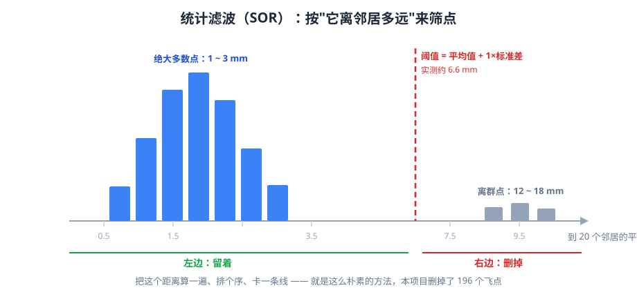

# 09 统计滤波与半径滤波

> 对应代码：`src/preprocessing/statistical_filter.h/.cpp`、`src/preprocessing/radius_filter.h/.cpp`
> 菜单入口：第 **4** 项（SOR）、第 **5** 项（ROR）
> 输出文件：`output/sor_k<meanK>_std<倍数>.pcd`、`output/ror_r<半径>_n<邻居数>.pcd`

**为什么把两个算法写在一份文档里？**

因为它们解决**同一个问题**（去掉离群点），只是**判断标准不同**：

| | SOR | ROR |
|---|---|---|
| 判断依据 | 到邻居的**平均距离** | **半径内有多少个邻居** |
| 参数 | `meanK`、`stdDevMulThresh` | `radius`、`minNeighbors` |
| 像什么 | "你离大部队太远了" | "你周围太冷清了" |

**对照着学，你会更清楚"为什么有两种"。**

---

## 1. 它们解决什么问题

原始点云里有 200 个"飞点"（离群点）—— 它们随机散落在管道和平板周围的空域里：

```
     ·                    ← 飞点
          ╔═══════╗
       ·  ║ 管道  ║       ← 真实点云（密集、连续）
          ║       ║   ·
          ╚═══════╝
    ·                ·
```

**这 200 个点会毒害后续所有算法**：

- **欧氏聚类**：如果两个飞点碰巧靠近，会形成一个"2 个点的簇"（如果 `minSize` 设得小）
- **法向估计**：飞点周围的邻居关系是随机的，算出的法向完全错误
- **RANSAC**：3 个随机点如果刚好选中 2 个飞点 + 1 个真实点，拟合出的平面是垃圾
  （虽然有 1000 次迭代来剔除，但效率降低）
- **曲率计算**：飞点的"局部曲率"极大，会被误判为特征点

**目标**：把这 200 个点删掉，**同时尽量不伤及真实点**。

**这个"同时"是关键。** 所有离群点滤波都要在"删掉多少噪声"和"误删多少真点"之间取舍。

---

## 2. 直观几何解释



横轴是**每个点到它最近 20 个邻居的平均距离**。
绝大多数正常点都挤在左边（1~3mm），飞点孤零零地待在右边（12~18mm）。
中间卡一条红线，右边的全删 —— 就这么简单。

### SOR：看"你离邻居多远"

对**每一个点**，做三件事：

```
第 1 步：找到它最近的 k 个邻居（默认 k = 20）
第 2 步：算它到这些邻居的平均距离 dᵢ
第 3 步：统计全体点的 dᵢ 的均值 μ 和标准差 σ
        → 如果 dᵢ 远大于 μ，就是离群点
```

**用图表示**：

```
真实点（密集区）：
     • • •
    • • • •     这个点到 20 个邻居的平均距离 ≈ 1.5mm
     • • •      （和"平均点间距"一个量级）

飞点（孤立）：
                    •
                   （最近的邻居在 60mm 外）
      • • •        平均距离 ≈ 60mm
     • • • •       比 1.5mm 大了 40 倍！
```

**判断阈值**：

$$
T = \mu + \alpha \cdot \sigma
$$

其中 $\alpha$ 就是 `stdDevMulThresh`（默认 1.0）。

**如果某点的平均距离 $d_i > T$，它被标记为离群点。**

### 为什么用"μ + α·σ"而不是"固定距离阈值"？

因为**不同点云的密度不同**。管道扫描 1.5mm 间距、精细扫描 0.3mm 间距，
用固定的"距离 > 5mm 就算噪声"显然不行。

**μ + α·σ 是自适应的**：它自动适应了点云的整体密度。

**这是统计学里最常见的思想**：假设"正常点的平均距离"服从正态分布，
那么超过 μ+σ 的点只有约 16%，超过 μ+2σ 的只有约 2.3%。

### ROR：看"你周围有几个点"

对**每一个点**：

```
第 1 步：以它为中心，画一个半径 r 的球（默认 r = 3mm）
第 2 步：数球里有多少个其他点
第 3 步：如果少于 minNeighbors 个（默认 6），删掉它
```

**用图表示**：

```
真实点（密集区）：                飞点（孤立）：
   ┌─────────┐                    ┌─────────┐
   │  •   •  │  r=3mm 圈里有       │         │  r=3mm 圈里有
   │ •  •  • │  8 个邻居 ✓         │    •    │  0 个邻居 ✗
   │  •   •  │                    │         │
   └─────────┘                    └─────────┘
```

---

## 3. 必要数学

### SOR 的完整流程

设点云有 $n$ 个点 $P = \{p_1, \dots, p_n\}$。

**第 1 步**：对每个 $p_i$，用 KD-Tree 找它的 $k$ 个最近邻
（**不含自己**），记邻居距离为 $d_{i,1}, d_{i,2}, \dots, d_{i,k}$。

**第 2 步**：算平均距离

$$
\bar{d}_i = \frac{1}{k}\sum_{j=1}^{k} d_{i,j}
$$

**第 3 步**：算全体 $\bar{d}_i$ 的均值和标准差

$$
\mu = \frac{1}{n}\sum_{i=1}^{n}\bar{d}_i,
\qquad
\sigma = \sqrt{\frac{1}{n-1}\sum_{i=1}^{n}(\bar{d}_i - \mu)^2}
$$

**第 4 步**：标记离群点

$$
\text{若 } \bar{d}_i > \mu + \alpha\sigma,\ \text{则 } p_i \text{ 是离群点}
$$

**注意**：这里 $\sigma$ 的分母是 $n-1$（**样本标准差**，无偏估计），不是 $n$。
PCL 内部用的是 `std::sqrt(variance / (n - 1))`。

### 用本项目的数字估一下

- 平均点间距 $d \approx 1.470$ mm
- 所以真实点的 $\bar{d}_i \approx 1.470$ mm 左右（略大一点，因为有 20 个邻居时
  平均距离会比最近邻距离大）

**飞点的 $\bar{d}_i$ 有多大？**

200 个飞点均匀散布在 $360\times360\times360$ mm 的立方体里
（`outlierBoxHalf = 180`，坐标范围 `[-180, 180]`）。

飞点的平均间距 ≈ 立方体体积 / 点数 的立方根：

$$
\sqrt[3]{\frac{360^3}{200}} = \frac{360}{\sqrt[3]{200}} = \frac{360}{5.85} \approx 61.5 \text{ mm}
$$

**所以飞点的 $\bar{d}_i$ 大约 60mm 量级，真实点约 1.5mm 量级 —— 差 40 倍。**

**这个差距极大**，所以 `stdDevMulThresh = 1.0` 就足够把飞点全挑出来了。

### 阈值会是多少？

$\mu$ 是所有点平均距离的均值。

- 真实点 30051 个，$\bar{d}_i \approx 1.5$ mm
- 飞点 200 个，$\bar{d}_i \approx 60$ mm

$$
\mu \approx \frac{30051 \times 1.5 + 200 \times 60}{30251}
= \frac{45077 + 12000}{30251} \approx 1.89 \text{ mm}
$$

**注意**：200 个飞点把 $\mu$ 从 1.5 拉到了 1.89！**这就是离群点对统计量的污染。**

**阈值** $T = 1.89 + 1.0 \times \sigma$。

$\sigma$ 主要来自飞点的巨大偏离：

$$
\sigma \approx \sqrt{\frac{30051 \times (1.5-1.89)^2 + 200 \times (60-1.89)^2}{30250}}
\approx \sqrt{\frac{4570 + 675000}{30250}} \approx \sqrt{22.5} \approx 4.7
$$

**所以 $T \approx 1.89 + 4.7 = 6.6$ mm。**

**真实点（1.5mm）远小于 6.6 → 保留。飞点（60mm）远大于 6.6 → 删除。**

**实测：删掉 196 个，剩 30055 个。** 和估算一致（196 vs 200，见第 9 节解释）。

### ROR 的数学

对每个点 $p_i$：

$$
N_i(r) = \left|\{p_j : \|p_j - p_i\| \le r,\ j \ne i\}\right|
$$

$$
\text{若 } N_i(r) < m,\ \text{则 } p_i \text{ 是离群点}
$$

$m$ 就是 `minNeighbors`。

**注意 PCL 的一个细节**：`setMinNeighborsInRadius(m)` 的语义是
**"半径内至少要有 m 个点（含它自己）"**。所以"不含自己的邻居数"是 $m-1$。

**本项目 `minNeighbors = 6`**，意味着"半径 3mm 内（含自己）至少 6 个点"。

### ROR 的球内点数容量估算

半径 $r = 3$ mm，点间距 $d = 1.470$ mm。球体积：

$$
V = \frac{4}{3}\pi r^3 = \frac{4}{3}\pi \times 27 = 113.1 \text{ mm}^3
$$

每个点"占"的体积 ≈ $d^3$ 吗？**不对** —— 点云是**曲面**采样，不是体采样。
**球内点数 ≈ 球被曲面切出来的面积 / 每个点的面积**：

球与曲面相交的圆盘面积 ≈ $\pi r^2 = 28.3$ mm²

每个点占面积 ≈ $d^2 = 2.16$ mm²

$$
\text{球内点数} \approx \frac{28.3}{2.16} \approx 13
$$

**所以 `r=3, m=6` 对真实点是很宽松的**（真实点有 13 个邻居，远超 6）。

**但对稀疏区域就危险了** —— 见第 6 节。

---

## 4. 输入数据和输出数据

| | SOR | ROR |
|---|---|---|
| 输入 | `data/scene_original.pcd`（30251 点） | 同 |
| 输出（正常） | `output/sor_k20_std1.00.pcd`（30055 点） | `output/ror_r3.00_n6.pcd`（29792 点） |
| 输出（反选） | `output/sor_negative_k20_std1.00.pcd`（196 点） | `output/ror_negative_r3.00_n6.pcd`（459 点） |
| 点的含义 | 被保留的原始点（**不是新造的点**） | 同 |

**重要区别**：体素降采样的输出是**新造的点**（质心），
而 SOR/ROR 的输出是**原始点的子集** —— 所有点的坐标都没变。

**这可以用哈希验证**：`sor_k20_std1.00.pcd` 里每个点的坐标，
一定能在 `scene_original.pcd` 里找到一模一样的。

### 反选（`setNegative`）的用途

`negative = true` 时，输出的是**被删掉的那些点**。

**这是调试离群点滤波最好的工具**：把它存下来，打开看看，"被删的到底是不是飞点？"

**如果反选结果是管道的边缘点，说明参数设错了（删太多）。**

---

## 5. 关键参数

### SOR：`src/preprocessing/statistical_filter.h`

```cpp
struct StatisticalOptions
{
    int    meanK          = 20;    // 看多少个邻居
    double stdDevMulThresh = 1.0;  // 阈值 = μ + 这个倍数 × σ
    bool   negative       = false; // 反选
};
```

| 参数 | 含义 | 默认值 | 调大 | 调小 |
|---|---|---|---|---|
| `meanK` | 取多少个邻居算平均距离 | 20 | 更抗局部噪声，但算得慢，且会"看不清局部" | 更敏感，但容易被单个坏邻居带偏 |
| `stdDevMulThresh` | 阈值 = μ + α·σ 中的 α | 1.0 | **删得更少**（阈值变高） | **删得更多**（阈值变低） |
| `negative` | 反选 | false | — | — |

**`meanK` 的合理范围**：10 ~ 50。低于 10 时统计不稳定（20 个样本才算像样的均值）。

**代码里的检查**（`statistical_filter.cpp:27-38`）：

```cpp
if (opt.meanK < 2)  → 报错
if (opt.stdDevMulThresh <= 0.0) → 报错
```

**为什么 `meanK < 2` 报错？** 因为 1 个邻居时"平均距离"就等于"最近邻距离"，
标准差算出来没意义（虽然数学上能算）。PCL 也要求 ≥ 1，本项目定 2 更严格。

### ROR：`src/preprocessing/radius_filter.h`

```cpp
struct RadiusOptions
{
    double radius       = 3.0;   // 搜索半径（mm）
    int    minNeighbors = 6;     // 半径内至少多少个点（含自己）
    bool   negative     = false; // 反选
};
```

| 参数 | 含义 | 默认值 | 调大 | 调小 |
|---|---|---|---|---|
| `radius` | 球的半径 | 3.0 mm | 每个点都会"看到"更多邻居 → **删得更少** | 邻居变少 → **删得更多** |
| `minNeighbors` | 最少点数（含自己） | 6 | **删得更多**（要求更严格） | **删得更少** |
| `negative` | 反选 | false | — | — |

**`radius` 必须和点间距挂钩**：$r$ 至少要能装下 3~5 个点间距，
否则连真实点都会被删。本项目 $r/d = 3.0/1.47 = 2.04$，**偏小**（见第 6 节）。

---

## 6. 参数变大或变小会怎样

### SOR：`stdDevMulThresh` 扫描

| `stdDevMulThresh` | 预期行为 |
|---|---|
| 0.1 | 只保留"平均距离"最接近 μ 的点 → **删太多**（大约删 40%+） |
| 1.0（默认） | 删 196 个（正好是飞点）✓ |
| 2.0 | 删得更少（阈值 1.89+2×4.7=11.3mm，飞点 60mm 仍超）→ 可能还删 196 个 |
| 5.0 | 阈值 1.89+5×4.7=25.4mm，飞点 60mm 仍超 → 还是删 196 个 |
| 20.0 | 阈值 1.89+20×4.7=96mm > 60mm → **一个都不删** |

**有意思的发现**：因为飞点的 $\bar{d}_i$（60mm）和真实点（1.5mm）差了两个数量级，
**中间一大段阈值都能正确工作**（6.6mm 到 25mm 都行）。

**这说明：参数调对了，容错空间很大；参数调错了，结果会突然崩。**

**但注意**：$\sigma$ 被飞点污染了（4.7 而不是真实点的 0.1 左右）。
如果飞点更多（比如 2000 个），$\mu$ 和 $\sigma$ 会被拉到飞点那一侧，
**阈值就会失效**。

**这是 SOR 的一个根本缺陷**：它用**全体点**的统计量，而离群点本身会污染这个统计量。

**工业界的做法**：先粗筛（按距离范围删掉明显的远点）再跑 SOR。

### SOR：`meanK` 扫描

| `meanK` | 预期 |
|---|---|
| 2 | 平均距离 ≈ 最近邻距离，噪声大，删除数量波动大 |
| 20（默认） | 稳定 |
| 100 | 更平滑，但"看不清局部"，且慢 |

### ROR：`radius` 扫描

**这是 ROR 最需要小心的地方。**

| `radius` | 会发生什么 |
|---|---|
| 0.5 mm | 几乎每个点的球里都只有自己 → **全删光** |
| 1.5 mm | 勉强装下 1 个邻居 → **删掉大量真实点** |
| 3.0（默认） | 球内约 13 个点，但**管道边缘处不足 6 个** → 实测删 459 个 |
| 5.0 mm | 球内约 36 个点 → 删得更少，飞点仍被删 |
| 10.0 mm | 球内约 143 个点 → **飞点也可能通过**（如果飞点附近有真实点） |

**实测：`r=3.0, n=6` 删掉 459 个。**

**注意这个数字**：

- 飞点只有 200 个
- 删了 459 个
- **多删了 259 个真实点**

**哪些是真实点被误删的？** 主要是：

1. **管道端面边缘**（θ 接近 ±100° 的视角遮蔽边界处）—— 那里点密度骤降
2. **平板边缘**（160×100mm 的平板四周）—— 边界外没有点
3. **坡口斜面上靠近钝边的地方**（点间距变大）

**这是 ROR 的典型行为**：它**对边界特别敏感**，因为边界点的"球内点数"天然更少。

**这也解释了为什么工业上预处理流程常用 SOR 而不是 ROR** ——
SOR 看的是"距离"，边界点的平均距离不会因为"靠近边界"而变大。

`src/preprocessing/radius_filter.cpp:33-38` 里有参数检查：

```cpp
if (opt.minNeighbors < 1)  → 报错
```

**为什么是 1 而不是 2？** 因为 PCL 的语义是"含自己"，
`minNeighbors = 1` 意味着"半径里有自己就够了" → **保留所有点**（等于不删）。

---

## 7. 本项目的代码逐段解释

### SOR：`src/preprocessing/statistical_filter.cpp`（75 行）

#### 第 1 段：参数检查（21-38 行）

```cpp
if (opt.meanK < 2)
{
    result.summary = "meanK 太小，未执行";
    printError("meanK 至少要 2（要能算出'到邻居的距离'）");
    return result;
}
if (opt.stdDevMulThresh <= 0.0)
{
    result.summary = "阈值必须为正，未执行";
    printError("倍数阈值必须大于 0");
    return result;
}
```

**注意"未执行"三个字出现在 `summary` 里。**

这是给菜单层用的：`printAlgoResult()` 看到 `summary` 就知道这次有没有真的跑。
**如果算法没跑，`result.cloud` 是空的，菜单就不会去打印"输出点数"。**

#### 第 2 段：组装（40-44 行）

```cpp
pcl::StatisticalOutlierRemoval<PointT> sor;
sor.setInputCloud(input);
sor.setMeanK(opt.meanK);
sor.setStddevMulThresh(opt.stdDevMulThresh);
sor.setNegative(opt.negative);
```

**`setStddevMulThresh` 的拼写要注意**：是 `Stddev` 不是 `StdDev`，
不是 `StdMulThresh`。**PCL 的命名不统一，记不住就靠 IDE 补全。**

**`setNegative` 是所有 PCL filter 共有的方法。**

#### 第 3 段：执行（46-47 行）

```cpp
CloudPtr output(new CloudT);
sor.filter(*output);
```

和体素降采样完全一样的两行。**这是 PCL filter 的统一接口**：

```cpp
Filter<PointT> f;
f.setInputCloud(input);
f.setSomeParameters(...);
f.filter(*output);
```

**记住这个模式，PCL 的 90% 滤波器都能用了。**

#### 第 4 段：指标（49-58 行）

```cpp
result.metrics["meanK"]    = static_cast<double>(opt.meanK);
result.metrics["倍数阈值"] = opt.stdDevMulThresh;
result.metrics["输入点数"] = n_in;
result.metrics["输出点数"] = n_out;
result.metrics["删除点数"] = n_in - n_out;
result.metrics["保留比例"] = (n_in > 0.0) ? n_out / n_in : 0.0;
```

**`int` 转 `double`**：因为 `metrics` 的值类型是 `double`。
`static_cast<double>(opt.meanK)` 是必须的，否则 `int` 赋给 `double` 会有隐式转换警告。

**菜单打印时**，`printAlgoResult()` 会检查值是不是整数：

```cpp
// 整数就按整数打印，避免 "20.000 个邻居" 这种怪输出
if (v == std::floor(v))  → 打印整数
```

#### 第 5 段：文件名（60-63 行）

```cpp
std::ostringstream tag;
tag << "k" << opt.meanK << "_std" << std::fixed << std::setprecision(2)
    << opt.stdDevMulThresh;
result.output_path = saveOutput(opt.negative ? "sor_negative" : "sor", tag.str(), output);
```

**注意 `opt.negative ? "sor_negative" : "sor"`** ——
反选的结果用**不同的算法名前缀**，这样：

```
output/sor_k20_std1.00.pcd             ← 正常：保留下来的点
output/sor_negative_k20_std1.00.pcd    ← 反选：被删掉的点
```

**两个文件并存，能直接对比** —— 这是"留后路"的另一种形式。

### ROR：`src/preprocessing/radius_filter.cpp`（75 行）

结构和 SOR **几乎一模一样**。只有三处不同：

#### 不同点 1：参数名（40-44 行）

```cpp
pcl::RadiusOutlierRemoval<PointT> ror;
ror.setInputCloud(input);
ror.setRadiusSearch(opt.radius);
ror.setMinNeighborsInRadius(opt.minNeighbors);
ror.setNegative(opt.negative);
```

**注意 `setRadiusSearch` 而不是 `setRadius`。**
PCL 里还有 `setMinNeighborsInRadius`（不是 `setMinNeighbors`）。

#### 不同点 2：指标名（53-58 行）

```cpp
result.metrics["搜索半径(mm)"] = opt.radius;
result.metrics["最少邻居数"]   = static_cast<double>(opt.minNeighbors);
```

#### 不同点 3：文件名前缀（61-63 行）

```cpp
tag << "r" << std::fixed << std::setprecision(2) << opt.radius
    << "_n" << opt.minNeighbors;
result.output_path = saveOutput(opt.negative ? "ror_negative" : "ror", tag.str(), output);
```

**`<< "_n" << opt.minNeighbors`** 这里 `minNeighbors` 是 `int`，
ostringstream 会按整数输出（不带小数点）。**这是对的**，因为邻居数就是整数。

**对比 SOR 的 `setprecision(2)`**：SOR 的 `meanK` 也是 int，所以
`tag << "k" << opt.meanK` 直接输出整数，不受 `setprecision` 影响
（`setprecision` 只影响浮点数）。**这个细节说明 C++ 的流格式化是有状态的，
容易写出意外结果。**

---

## 8. 怎么编译和运行

### SOR

```powershell
. E:\PointCloudEnv\env.ps1   # 通常不需要：DLL 已在 exe 旁边
cd E:\dianyunxulian
cmake --build build --config Release
.\build\Release\PointCloudPractice.exe
```

菜单选 **4**，然后：

```
meanK [20]:                     ← 回车用默认
标准差倍数阈值 [1.0]:            ← 回车用默认
反选（输出被删掉的点）[否]:       ← 回车用默认（否）
```

**预期输出**：

```
══════════════════════════════════════════════════════
  统计离群点滤波（SOR）
══════════════════════════════════════════════════════
  读入原始点云: data/scene_original.pcd

  统计滤波完成
  meanK          : 20
  倍数阈值       : 1.000
  输入点数       : 30251
  输出点数       : 30055
  删除点数       : 196
  保留比例       : 0.9935
  已保存         : output/sor_k20_std1.00.pcd
```

### ROR

菜单选 **5**：

```
搜索半径(mm) [3.0]:             ← 回车
半径内最少点数（含自己）[6]:      ← 回车
反选 [否]:                       ← 回车
```

**预期输出**：

```
  半径滤波完成
  搜索半径(mm)   : 3.000
  最少邻居数     : 6
  输入点数       : 30251
  输出点数       : 29792
  删除点数       : 459
  保留比例       : 0.9848
  已保存         : output/ror_r3.00_n6.pcd
```

### 看"被删的是不是飞点"（反选）

再跑一次，**反选选"是"**：

```
output/sor_negative_k20_std1.00.pcd     ← 196 个点
```

打不开 PCD？用 `Get-Content` 看头部：

```powershell
Get-Content .\output\sor_negative_k20_std1.00.pcd -TotalCount 11
```

```
WIDTH 196
```

**196 个点 = 被删的离群点。** 这就是"反选"的价值。

---

## 9. 怎么检查结果是否合理

### SOR 检查

#### 检查 1：删除数应该 ≈ 飞点数

**飞点 200 个，删了 196 个 —— 差 4 个。**

**为什么不是正好 200？**

因为 **"离群"是相互的**。如果**两个飞点恰好彼此靠近**（距离 < 阈值），
它们就把对方的"平均距离"拉低了，从而通过检查。

**估算一下概率**：200 个点在 360³ 的空间里，平均间距 61.5mm。
"两个飞点距离 < 6.6mm"（阈值）的概率 ≈

$$
P \approx 1 - \exp\left(-\frac{4}{3}\pi R^3 \cdot \frac{n-1}{V}\right)
= 1 - \exp\left(-\frac{4}{3}\pi \times 6.6^3 \times \frac{199}{360^3}\right)
\approx 1 - \exp(-0.0013) \approx 0.13\%
$$

**每个飞点有 0.13% 的概率有"近邻"**，200 个点 → 期望 0.26 个点成对。
**但实际上还有另一种情况**：飞点落在管道**附近**（距离管道表面 < 6.6mm），
那么它最近的 20 个邻居里有一部分是真实点，平均距离被拉低。

飞点分布在 ±180 的立方体，管道半径 50、平板在 y=200 ——
飞点落在"管道表面 6.6mm 内"的概率约等于"柱壳体积/立方体体积"，约 1.5%。
200 × 1.5% ≈ 3 个。

**加上 0.26 个成对情况 ≈ 3.3 个 —— 和实测的 4 个非常接近。**

**这是"用概率估算解释实测差异"的完整过程。** 你以后遇到"数字有点对不上"，
都是这么查的。

#### 检查 2：反选结果里应该全是飞点

打开 `sor_negative_k20_std1.00.pcd`，看它的坐标范围。

飞点范围是 `[-180, 180]` 三个方向。**如果反选文件的坐标范围也是 ±180 左右，
说明删的确实是飞点。**

**如果反选文件的坐标范围是 ±50 左右**（管道范围），说明删错了。

#### 检查 3：保留比例应该 > 0.98

删除 196 / 30251 = 0.65%。**保留 99.35%**。

**如果保留比例只有 0.8**，说明阈值太严，删掉了大量真实点。

### ROR 检查

#### 检查 1：删除数会明显多于飞点数

**飞点 200 个，删了 459 个 —— 多删 259 个。**

**这是 ROR 的正常行为，不是 bug。** 原因见第 6 节（边界点天然邻居少）。

**怎么验证这 259 个是边界点？**

```powershell
# 看被删的点（反选）
Get-Content .\output\ror_negative_r3.00_n6.pcd -TotalCount 8
```

然后把它们可视化（或用 CloudCompare），你会看到它们**集中在管道两端和平板四边**。

#### 检查 2：ROR 通常是"删少了"而不是"删多了"

反直觉的是，**ROR 容易删得不够**：

如果飞点旁边刚好有个真实点云（比如飞点贴着管道表面 1mm），
那么飞点的 r=3mm 球里会有真实点 → 通过检查。

**本项目 200 个飞点里有 0~5 个落在这个位置**，所以 ROR 至少漏掉几个。

#### 检查 3：用 SOR 的结果做交叉验证

**这是个非常实用的技巧**：

1. 先跑 SOR，得 30055 点
2. 再跑 ROR，得 29792 点
3. **两者差 263 个**

**这 263 个是"ROR 删了但 SOR 没删"的点** —— 它们就是"ROR 认为稀疏、SOR 认为正常"的边界点。

**如果两个算法的删除数差异巨大**（比如 SOR 删 5000、ROR 删 200），
说明你的参数有一个设错了。

### 两个算法的最终对比

| | SOR（k=20, α=1.0） | ROR（r=3.0, m=6） |
|---|---|---|
| 删除点数 | 196 | 459 |
| 删除比例 | 0.65% | 1.52% |
| 删掉飞点的比例 | 196/200 = 98% | 约 195/200 = 97.5% |
| **误删真实点** | **约 0** | **约 259** |
| **边界点保护** | 好 | **差** |

**结论：本场景下 SOR 明显更好。**

---

## 10. 三个动手练习

### 练习 1（15 分钟）：`stdDevMulThresh` 的作用有多大

**做什么**：`meanK` 固定 20，`stdDevMulThresh` 依次取 0.1、0.5、1.0、2.0、5.0、20.0。

**填表**：

| α | 删除点数 | 保留比例 |
|---|---|---|
| 0.1 | | |
| 0.5 | | |
| 1.0 | 196 | 0.9935 |
| 2.0 | | |
| 5.0 | | |
| 20.0 | | |

**要回答**：

1. 从哪个 α 开始删除数不再变化？为什么？（提示：见第 3 节 $\mu + \alpha\sigma$ 的估算）
2. α = 0.1 时删了多少个？这些是飞点还是真实点？

<details>
<summary>提示</summary>

α = 0.1 时阈值是 $1.89 + 0.1\times4.7 = 2.36$mm。**真实点的平均距离 1.5mm 还在阈值内，
但有一部分真实点（特别是边界处）的平均距离会超过 2.36mm** → 误删开始出现。

α 很大时（比如 20），阈值 $1.89+20\times4.7=96$mm 超过飞点的 60mm → **一个都不删**。

</details>

### 练习 2（15 分钟）：ROR 的 `radius` 临界值

**做什么**：`minNeighbors` 固定 6，`radius` 依次取 0.5、1.0、1.5、2.0、3.0、5.0、10.0。

**要回答**：

1. `radius` 多少时删除数**剧增**？
2. 这个临界值和哪个几何量有关？（提示：点间距 1.47mm）
3. `radius = 10` 时删除数还会比 3.0 少吗？

<details>
<summary>提示</summary>

半径内点数 $\propto r^2$（球与曲面相交的圆盘面积）。

要让"至少 6 个点（含自己）"，需要 $r$ 至少能装下 5 个其他点，即 $r \gtrsim \sqrt{5} \cdot d \approx 2.24 \times 1.47 \approx 3.3$mm。

**所以理论临界点在 3.3mm 左右。** 实测在 3.0 附近已经开始大量误删，
这和估算一致。

</details>

### 练习 3（20 分钟）：设计一个"只用 SOR"的清洗流程

**任务**：写一份操作流程，目标是"删掉全部 200 个飞点，同时删除的真实点少于 50 个"。

**允许的操作**：反复运行 SOR/ROR，每次用不同参数，中间可以看反选结果。

**提示**：

- SOR 的 `meanK` 增大到 30 或 50，看删除数怎么变
- 先跑 SOR（删 196），再对结果跑一次 SOR？—— **不行，菜单固定读原始文件**

**所以这个练习的正确答案是"做不到"**，而这正是要你发现的：

**当前项目的架构不允许算法串联**（每个算法独立读 `data/scene_original.pcd`），
这是**故意的** —— 见 [02_项目目录与多文件C++.md](02_项目目录与多文件C++.md) 和 README 的"算法独立运行"一节。

**要真正串起来，需要改代码**：

```cpp
// 在 menu_items.cpp 里写一个"任务"型 action（不是单算法实验）
AlgoResult r1 = runStatisticalOutlierRemoval(orig, opt1);
AlgoResult r2 = runRadiusOutlierRemoval(r1.cloud, opt2);   // 用上一步结果
```

**这就是本项目"单算法实验"和"任务演示"两类菜单的区别。**

**做完这个练习，你就理解了为什么项目要这么设计。**

---

## 11. 常见报错

### `error C2039: "StatisticalOutlierRemoval": 不是 "pcl" 的成员`

**缺头文件**：

```cpp
#include <pcl/filters/statistical_outlier_removal.h>
```

注意路径是 `pcl/filters/`，不是 `pcl/segmentation/`。

### `error C2065: "RadiusOutlierRemoval": 未声明的标识符`

缺头文件：

```cpp
#include <pcl/filters/radius_outlier_removal.h>
```

### `error LNK2019: 无法解析的外部符号 ... pcl::KdTreeFLANN...`

SOR 和 ROR **内部都用了 KD-Tree** 来找邻居。如果 CMake 里少了 `kdtree` 组件，会链接失败。

检查 `CMakeLists.txt` 的 `find_package` 是否有 `kdtree`。

### 删除了 0 个点

**三个可能**：

1. `stdDevMulThresh` 太大（见练习 1）
2. `radius` 太大 / `minNeighbors` 太小（ROR）
3. **点云本来就没有离群点**（检查你是不是在读 `voxel_leaf2.000.pcd` 这种已处理过的文件）

### 删除了 90% 的点

**可能**：

1. `stdDevMulThresh` 太小（比如 0.01）
2. `radius` 太小（比如 0.5）
3. `meanK` 太小（比如 2）

**先跑一次反选，看看被删的是什么。** 如果是一大片连续区域，就是参数错了。

### 程序运行很慢（超过 10 秒）

SOR/ROR 要对**每个点**做 KD-Tree 查询，复杂度 O(n log n)。

- 30251 点：**< 1 秒**
- 300 万点：**几分钟**

**真实数据要先用体素降采样再用 SOR。** 但注意顺序问题（见下）。

---

## 12. 与管道焊缝点云处理的联系

### 联系 1：线激光扫描的噪声特性和本项目不同

**本项目的噪声**：三个方向独立的高斯分布，σ = 0.05mm（`noiseSigma`）。

**真实线激光的噪声**：

- **沿激光视线方向**（深度方向）的噪声最大（±0.1~1mm，取决于距离和材料）
- **垂直方向**（沿激光条纹）的噪声很小（亚像素精度，±0.02mm）
- 还有**系统性误差**：反射率变化、多次反射、被测面倾斜

**后果**：真实噪声是**各向异性**的，而 SOR 假设"平均距离"这个单变量能反映离群程度。

**应对**：真实数据上通常还要做"双边滤波"（保边平滑）或"沿视线的深度校正"。
本项目只有 SOR/ROR 两种，因为合成噪声是各向同性的。

### 联系 2：飞点对焊缝特征提取的破坏

**场景**：坡口边缘的张口宽度 b 要测量两侧边缘的距离。

**如果有一个飞点落在坡口上方**：

- 边缘检测会把它当成"坡口边缘的一部分"
- 测出的 b 可能偏大 20mm（飞点位置随机）

**这是"必须先滤波"的最直接理由。** 焊缝特征提取的精度直接取决于点云干净程度。

### 联系 3：ROR 在焊缝场景里更危险

**坡口斜面是"稀疏区"**：

- 激光斜射到 30° 斜面上 → 投影拉长 → 点变稀
- 钝边只有 2mm 宽 → 那个区域点本来就少

**如果用 ROR，会把整个坡口区域删掉**（因为那里"邻居太少"）。

**所以焊缝点云处理的工业实践是**：

1. 用 **SOR** 或 **半径滤波但半径很大**（比如 5~10mm）
2. **绝不用小半径的 ROR**
3. 或者用"基于密度的聚类"（DBSCAN）区分噪声和结构

**本项目让你亲手跑一次 ROR 看到它删 459 个点（其中 259 个是真点），
就是为了让你体会这个陷阱。**

### 联系 4：`meanK` 和"焊缝宽度"的关系

焊缝宽度 10~20mm，点间距 1mm → 焊缝横跨 10~20 个点。

**SOR 的 `meanK = 20` 意味着：一个点的"邻居圈"大约覆盖焊缝宽度。**

**如果 `meanK` 设得太大**（比如 200），邻居圈覆盖 200 个点 ≈ 焊缝宽度的 3~4 倍，
那么"焊缝内部的点"和"母材上的点"平均距离变得差不多 →
**焊缝边缘的细节会被统计量抹平**。

**经验法则**：`meanK` 应该让你关心的最小特征的尺度上，有 10~30 个点。

---

## 13. 算法在真实扫描数据中的局限

### SOR 的局限

| 局限 | 说明 | 本项目是否遇到 |
|---|---|---|
| **统计量被离群点污染** | μ 和 σ 用了全体点 | 遇到（μ 从 1.5 被拉到 1.89） |
| **假设噪声各向同性** | 真实激光噪声沿视线方向大 | 不遇到（合成噪声各向同性） |
| **密度不均匀时失效** | 稀疏区的真实点会被误删 | 不遇到（合成数据均匀） |
| **无法区分"稀疏结构"和"噪声"** | 坡口斜面被当成噪声 | 不遇到（但 `groove_pipe` 预设会） |
| **O(n log n)**，大点云慢 | 300 万点要几分钟 | 不遇到（3 万点） |
| **`negative` 反选是唯一的调试手段** | 没有"每个点的 d_i 值"输出 | 遇到（可以做扩展） |

### ROR 的局限

| 局限 | 说明 | 本项目是否遇到 |
|---|---|---|
| **边界点被误删** | 边界天然邻居少 | **遇到**（459-200 = 259） |
| **对密度变化极度敏感** | 稀疏区被整个删掉 | 不遇到（合成均匀） |
| **半径和点间距强耦合** | 换数据必须重调 | 不遇到（固定场景） |
| **无法处理"结构本身稀疏"** | 一根细线的点距 3mm，会被删 | 不遇到 |
| **不能区分"稀疏"和"离群"** | 这两个概念不同 | 遇到（这就是 259 的来源） |

### 共同局限：都只处理"点级"离群，不处理"结构化错误"

**真实扫描数据里还有一类错误，SOR/ROR 都无能为力**：

- **遮挡产生的"影子区"**：激光被焊缝挡住，后面一段没数据
- **多次反射**：激光在坡口内反射两次，产生"虚假点"（看起来在坡口里面）
- **拼接误差**：多视角拼接时，重叠区的点错位

**这些需要更高级的方法**（基于法向一致性、基于多视角一致性）。
本项目不做，因为合成数据没有这些问题。

---

## 下一步

- 想搞懂 SOR 内部怎么"找 20 个邻居" → [10_KDTree邻域搜索.md](10_KDTree邻域搜索.md)
- 想做"先降采样再滤波"的实验 → 先看 [08_VoxelGrid体素降采样.md](08_VoxelGrid体素降采样.md) 的练习 3
- 卡住了 → [14_项目练习与故障排查.md](14_项目练习与故障排查.md)
