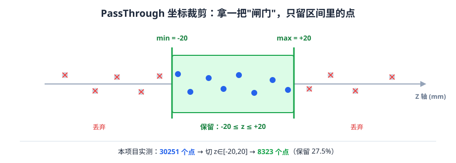

# 11 PassThrough 坐标裁剪

> 代码：[`src/segmentation/passthrough_demo.cpp`](../src/segmentation/passthrough_demo.cpp)、
> [`src/segmentation/passthrough_demo.h`](../src/segmentation/passthrough_demo.h)
> 菜单：**8**

---

## 一、这个算法解决什么问题

一句话：**按某个坐标轴，把范围外的点整片切掉。**

想象你站在一个巨大的仓库里，里面堆满了点。你想只研究"离地面 1 米到 1.2 米那一层"的东西 ——
PassThrough 就是一把**在某个方向上开了一道缝的板子**，只有落在缝里的点能通过。

它跟 RANSAC、聚类的区别在于：**它不"理解"几何。**

- RANSAC 会问"这些点能不能组成一个平面" —— 需要计算
- 欧氏聚类会问"这些点彼此离得近不近" —— 需要搜索
- **PassThrough 只问"你的 z 坐标在不在 -20 到 20 之间"** —— 一次比较

**这是 PCL 里最便宜的操作之一**，时间复杂度 O(n)，就是遍历一遍比大小。

---

## 二、直观几何解释



绿框就是"闸门"：只有 z 落在 [-20, +20] 之间的点才放行（蓝点），
超过的两头全部丢掉（灰点打红叉）。**闸门只在一根轴上判断**，不看别的轴。

### 一维的"闸门"

```
       点云里的点，按 z 坐标排开

   z = -60   -40   -20        20    40    60
             ·  ·   ·    ·    ·  ·  ·  ·
                    ├──────────┤
                    这就是 PassThrough 的"缝"
                    缝里的点留下，缝外的丢掉
```

**关键点**：这个"缝"是**无限大**的。它只管 z，
x 和 y 是多少完全不影响 —— 所以被切出来的其实是一层**无限厚的板**。

### 在本项目的场景里看

我们的场景（默认 `pipe_plate`）是：

- **管道**：半径 50 mm，轴沿 X 方向。所以管道上任何一点的 y、z 都在 `[-50, 50]` 之内
- **平板**：在 y = 200 的位置，尺寸 160 × 100 mm
- **离群点**：撒在 ±180 的立方体里

现在设 `z ∈ [-20, 20]`：

```
        俯视（看 X-Z 平面）

   z
   +50 ┤      ╭────────╮            ← 管道上边缘
       │    ╭─╯        ╰─╮
   +20 ┼──╭─┼────────────┼─╮─────── ← 上边界
       │  │ │            │ │
    0  ┼──┼─┼────────────┼─┼───────
       │  │ │            │ │
   -20 ┼──╰─┼────────────┼─╯─────── ← 下边界
       │    ╰─╮        ╭─╯
   -50 ┤      ╰────────╯
       └──┬────────────┬──→ x
        -90            90

   留下的是中间那条"带子"（管道被"割"下来的一个环带）
```

**注意**：管道是被轴沿 X 的圆柱，z 是横向坐标。
所以 `z ∈ [-20, 20]` 切出来的是**管道中间那一条环带**，
两端"帽"的部分（z 接近 ±50 的地方）被切掉了。

### 和"切片"的关系（重要）

如果你**同时**限制两个方向，就能切出一个薄片：

```cpp
z ∈ [-20, 20]   →  一条环带（只有两条边）
```

再套一次 PassThrough 限制 x：

```
x ∈ [-10, 10]   →  一个矩形薄片（四条边都封住了）
```

**但本项目每次只做一次 PassThrough**（保持"单算法"原则）。
真正做焊缝切片需要串联两次 —— 那是任务层的事，见 [第 12 节](#十二与管道焊缝点云处理的联系)。
**手动跑两次也是完全可以的**：第一次的结果存到 `output/`，第二次读它就行。

---

## 三、数学原理（真的很简单）

### 判定条件

对每个点 $p_i = (x_i, y_i, z_i)$，设裁剪轴是 $z$，范围 $[z_{min}, z_{max}]$：

$$
p_i \text{ 保留} \iff z_{min} \le z_i \le z_{max}
$$

**注意这里是闭区间**（两头都包含）。PCL 的实现是：

```cpp
if ((!negative && (value >= min && value <= max)) ||
    ( negative && (value <  min ||  value >  max)))
```

看清楚：**正选用 `>=` 和 `<=`，反选用 `<` 和 `>`** —— 反选时边界点**不**保留。
这个细节在边界上有几个点时会有微小差别。

### 时间复杂度

$$O(n)$$

n 是点数。**没有任何搜索、没有任何排序、没有任何迭代。**

对比一下：

| 操作 | 复杂度 | 本场景 30251 点耗时 |
|---|---|---|
| PassThrough | $O(n)$ | 微秒级 |
| VoxelGrid | $O(n)$（但要算哈希） | 毫秒级 |
| RANSAC | $O(k \cdot n)$，k=迭代次数 | 1000 次迭代约 100 毫秒 |
| KD-Tree 建树 | $O(n \log n)$ | 毫秒级 |
| 欧氏聚类 | $O(n \log n)$ ~ $O(n \cdot k)$ | 几十毫秒 |

**PassThrough 是里面最快的一个。** 这不是"它简单所以没用"，
恰恰相反：**在真正做焊缝特征时，第一步就是用 PassThrough 切出感兴趣的那一段。**

### 为什么它不"损失几何精度"

它只是**挑选**点，不移动、不合并、不平均。

所以：

- **裁剪后的点，坐标和原来一模一样**
- **不会变稀疏**（范围内的点一个不多一个不少）

这一点和 VoxelGrid 有本质区别（体素会合并点、坐标会变）。

---

## 四、输入与输出

| | 内容 |
|---|---|
| **输入** | `data/scene_original.pcd`（30251 点）＋ 4 个参数 |
| **输出** | `output/passthrough_<轴>_<下限>_to_<上限>.pcd` |
| **反选时** | `output/passthrough_negative_<轴>_<下限>_to_<上限>.pcd` |
| **控制台** | 下限 / 上限 / 输入点数 / 输出点数 / 保留比例 |

文件名里的数字是**参数本身**，所以不同参数跑出来的结果**不会互相覆盖**——
这也是本项目所有算法的统一做法。

---

## 五、关键参数

### `field` —— 裁剪轴（`'x'` / `'y'` / `'z'`）

菜单里问"按哪个坐标裁？(x / y / z)"。

**为什么必须让它可选？** 因为不同场景里"有意义的方向"不同：

| 你想切什么 | 用哪个轴 |
|---|---|
| 管道沿轴方向的某一段 | `x`（本项目管道轴就是 X） |
| 管道"绷直"的那一侧（对着相机的那面） | `y` |
| 管道横截面的一条带 | `z` |

### `minLimit` / `maxLimit` —— 上下限（mm）

**这是最需要"用手感"的参数。** 选错范围，输出可能是 0 个点，也可能是等于输入。

怎么定？**先看菜单 2 的坐标范围**：

```
X 范围 : [-179.476, 169.643]
Y 范围 : [-178.475, 200.183]
Z 范围 : [-179.192, 178.132]
```

这些范围**被离群点撑大了**（离群点撒在 ±180 的盒子里）。
真实物体（管道）只在 `±50` 以内，平板在 `y=200` 附近。

**所以**：范围要按"你想留下的物体"来定，不能按"点云的最大范围"来定。

### `negative` —— 反选

`true` 时**反过来**：只保留范围**外**的点。

**什么时候用**：你想看看"被我丢掉的是些什么"。

比如 `z ∈ [-20,20]` 反选，你就能拿到管道两端那两段箍 ——
**如果输出的点比你以为的多很多，说明范围设错了。**

---

## 六、参数变大变小的效果

本项目的实测数据（场景 = 默认 `pipe_plate`，30251 点）：

| 参数 | 输出点数 | 保留比例 | 切出来的是什么 |
|---|---|---|---|
| `z ∈ [-20, 20]` | **8323** | 27.51% | 管道中间一条环带 |
| `z ∈ [-50, 50]` | **29758** | 98.37% | 几乎整个管道 + 平板的一部分 |
| `y ∈ [100, 300]` | **4163** | 13.76% | 平板 4131 点 + 落在这一层的 32 个飞点 |
| `x ∈ [-180, 0]` | **15132** | 50.02% | 管道的前一半（左右对称，正好一半） |

### 从这些数字能读出什么

**读法 1：`z ∈ [-50,50]` 保留了 98%，说明管道几乎全在 z 的 ±50 内。**

管道半径就是 50，所以 `z = ±50` 正好是管壁最高/最低点。
**留下的那 1.63%（约 493 点）是什么？** 主要是离群点，因为飞点撒在 ±180，大部分在 ±50 之外。

**读法 2：`y ∈ [100,300]` 输出 4163，而平板只有 4131 点。**

多出来的 32 个点是"飞点里恰好 y > 100 的那些"。
**431 − 4131 = 32**，这个差值就是"离群点污染"的直观量化。

**读法 3：`x ∈ [-180,0]` 正好保留一半（50.02%）。**

因为管道沿 X 对称，平板也关于 x=0 对称。**这类"正好一半"是很好的自检信号**——
如果你改了参数却得到 50.00% 之外一个很远的值，说明有东西不对称。

### 参数太小的后果

```
z ∈ [-0.5, 0.5]  →  输出可能只有 0 或 1 个点的"薄片"
```

**这不是 bug**，而是点云是**离散**的：两个点之间的空隙里没有点。
薄片正好落在两圈点之间时，一个点都切不到。

### 参数太大的后果

```
z ∈ [-200, 200]  →  输出 = 全部 30251 点
```

**等于没做。** 这是最常见的"我以为我在裁剪，其实没裁"的坑。

---

## 七、代码逐段解释

打开 [`src/segmentation/passthrough_demo.cpp`](../src/segmentation/passthrough_demo.cpp)。

### 第 1 段：两道防御（第 21–32 行）

```cpp
if (!input || input->empty())
{
    result.summary = "输入点云为空，未执行";
    printError("输入点云为空");
    return result;
}
if (opt.minLimit > opt.maxLimit)
{
    result.summary = "范围上下限写反了，未执行";
    printError("下限大于上限，请检查");
    return result;
}
```

**这就是参数校验。** 如果用户把下限填成 20、上限填成 -20，
PCL 不会报错，它会返回**空点云**，然后你要花半天才想明白为什么。

**在算法入口拦住明显错误，比在算法里猜要值钱得多。**

### 第 2 段：字段名转换（第 34–45 行）

```cpp
std::string fieldName;
switch (opt.field)
{
case 'x': case 'X': fieldName = "x"; break;
case 'y': case 'Y': fieldName = "y"; break;
case 'z': case 'Z': fieldName = "z"; break;
default:
    result.summary = "字段名不合法，未执行";
    printError("字段只能是 x / y / z");
    return result;
}
```

**为什么这里要转一次？** 因为 PCL 的 `setFilterFieldName()` 要的是
**字符串**（`"x"` / `"y"` / `"z"`），而不是字符。

这里面的坑很深：PCL 会按字段名去点类型的元数据里查。如果你写成
`"X"`（大写）或者 `"z "`（带空格），`setFilterFieldName` **不报错**，
但 `filter()` 时要么无效要么崩溃。

**所以 `switch` 里把大小写都收进来、并且给出明确的错误分支，是必要的。**

### 第 3 段：配置过滤器（第 47–51 行）

```cpp
pcl::PassThrough<PointT> pass;
pass.setInputCloud(input);
pass.setFilterFieldName(fieldName);
pass.setFilterLimits(static_cast<float>(opt.minLimit), static_cast<float>(opt.maxLimit));
pass.setNegative(opt.negative);
```

这一串就是 PCL 的**四步套路**：

1. `setInputCloud` —— 告诉它"处理哪份点云"
2. `setXxx` —— 设置这个算法特有的参数
3. `setNegative` —— 这个参数几乎所有 PCL 过滤器都有
4. `filter()` —— 真正干活

**注意 `static_cast<float>`**：`opt.minLimit` 是 `double`，PCL 的接口要 `float`。
**显式转换比隐式转换好**，因为编译器会在窄化时给警告，而 `static_cast` 表示
"我确认这不会丢精度"。在这个场景下（坐标量级 100 mm，`float` 精度约 0.00001 mm），
确实不丢精度。

### 第 4 段：真正执行（第 53–54 行）

```cpp
CloudPtr output(new CloudT);
pass.filter(*output);
```

**一行就干完了。** 但这一行背后 PCL 做的是：

```cpp
// PCL 内部逻辑（简化）
output->clear();
output->reserve(input->size());
for (const auto &point : input->points)
{
    const float value = point.z;      // 按字段名取坐标
    if (value >= min && value <= max)
        output->push_back(point);     // 只是拷贝，不改坐标
}
output->width = output->size();
output->height = 1;
```

**所以 PassThrough 本质上就是"一个带条件的拷贝循环"。**
理解这一点，你就不会对它有任何神秘感了。

### 第 5 段：统计与保存（第 56–71 行）

```cpp
const double n_in  = static_cast<double>(input->size());
const double n_out = static_cast<double>(output->size());

result.metrics["下限(mm)"]  = opt.minLimit;
result.metrics["上限(mm)"]  = opt.maxLimit;
result.metrics["输入点数"]  = n_in;
result.metrics["输出点数"]  = n_out;
result.metrics["保留比例"]  = (n_in > 0.0) ? n_out / n_in : 0.0;
```

**`(n_in > 0.0) ? ... : 0.0` 这个三元表达式是在防除零。**

虽然上面已经检查过 `input->empty()`，但**"我以为上游已经检查了"是 bug 的主要来源**。
在这里再检查一次，代价是一次比较，收益是永不除零。

```cpp
std::ostringstream tag;
tag << fieldName << "_" << std::fixed << std::setprecision(1)
    << opt.minLimit << "_to_" << opt.maxLimit;
```

**`std::ostringstream` 是"把数字拼成字符串"的标准做法。**
比 `std::to_string` 好在：可以控制小数位数（`setprecision(1)`）。

所以 `z, -20, 20` 会变成 `z_-20.0_to_20.0`，文件名就是
`output/passthrough_z_-20.0_to_20.0.pcd`。

**为什么文件名里要带参数？** 因为你要能一眼看出
"这个结果是用什么参数跑出来的"。攒了 20 个结果文件以后，你会感谢自己。

### 第 6 段：给人看的摘要（第 77–79 行）

```cpp
result.summary = "坐标裁剪完成（按 " + fieldName + " 轴，保留 " +
                 std::to_string(static_cast<long long>(opt.minLimit)) + " ~ " +
                 std::to_string(static_cast<long long>(opt.maxLimit)) + " mm）";
```

`static_cast<long long>` 是为了让 `to_string` 输出整数（`-20` 而不是 `-20.000000`）。

> **一个曾经踩过的坑**：早期版本往 `metrics` 里塞了一个 `裁剪字段 : 'z'`，
> 结果界面上显示成 `裁剪字段 : 122`。原因是 `char` 被当成整数打印了（'z' 的 ASCII 是 122）。
> 所以现在把轴的说明放进 `summary`（字符串），不放进 `metrics`（数字）。
> **`metrics` 里只放真正是数字的东西。**

---

## 八、编译和运行

```powershell
# 环境（必须，否则缺 DLL）
. E:\PointCloudEnv\env.ps1   # 通常不需要：DLL 已在 exe 旁边

# 编译（改过代码才需要）
cd E:\dianyunxulian
cmake --build build --config Release

# 运行
.\build\Release\PointCloudPractice.exe
```

菜单里选 **8**，然后依次回答：

```
按哪个坐标裁？(x / y / z) [z]:        ← 直接回车 = z
下限（保留 >= 这个值） [-20]:          ← 直接回车 = -20
上限（保留 <= 这个值） [20]:           ← 直接回车 = 20
是否反选（只保留范围外的点） [n]:       ← 直接回车 = 否
```

预期输出（实测）：

```
────────────────────────────────────────────────────────────────
  PassThrough 坐标裁剪
────────────────────────────────────────────────────────────────
  输入文件        : data\scene_original.pcd
  输入点数        : 30251
  下限(mm)        : -20.000
  上限(mm)        : 20.000
  输出点数        : 8323
  保留比例        : 0.275

  已保存          : output\passthrough_z_-20.0_to_20.0.pcd
```

---

## 九、检查结果是否合理

跑完之后，按这四条检查：

### 1. 点数对不对

用菜单 2 看原始点数（30251），用下面的式子大略估算：

$$
\frac{N_{out}}{N_{in}} \approx \frac{\text{被切中那部分的占比}}{100\%}
$$

**对环带来说，这个占比约等于"弧长比"**：

如果管道半径 R=50、切轴是 z，`z ∈ [-20, 20]` 对应圆心角
$\theta = 2\arcsin(20/50) = 2 \times 23.58° = 47.16°$，

占比 $\approx 47.16 / 180 = 26.2\%$（只算上半圈），但**下半圈同样有**，
所以实际是 $\approx 52.3\%$。

实测是 27.51%，比 52.3% 小。

**为什么？** 因为我们的场景**不是整圈**！
`viewAngleDeg` 默认 360（整圈），但这里的关键是：管道采样是"每个 θ 一圈周向点、每个 x 一个截面"的网格。
**z 是 $R\sin\theta$，z 小的地方对应的 θ 范围其实很大** —— 等等，让我重新算。

实际上：`z ∈ [-20,20]` 对应的 θ 满足 $|50\sin\theta| \le 20$，
即 $|\sin\theta| \le 0.4$，$\theta$ 落在 $[-23.58°, 23.58°]$ 和 $[156.42°, 203.58°]$。

**这两段的角宽度合计** $2 \times 47.16° = 94.3°$，

占比 $94.3 / 360 = 26.2\%$ —— **和实测 27.51% 非常接近**（差异来自平板和飞点的贡献）。

> **这就是"能核对"的意义**：算出来 26.2%，实测 27.51%，差 1.3 个百分点
> （平板在 z 范围内贡献了约 1300 点）。**对得上，就说明算法行为正确。**

### 2. 反选点数 = 输入 − 输出

跑一次 `z ∈ [-20,20]` 反选，输出应该是

```
30251 − 8323 = 21928
```

**这两个数加起来必须正好等于 30251**（不多不少）。
**如果差了几个，说明边界点被两边都算了或都没算** ——
这就是第三节里"正选用 `>=`，反选用 `>`"那个细节。

### 3. 用坐标范围验证

菜单 2 检查裁剪结果，看它的 Z 范围应该是 `[-20.000, 20.000]` 左右
（`float` 可能有 1e-5 的误差）。

**如果不是，说明裁剪没生效** —— 最常见原因是字段名传错了。

### 4. 视觉检查（如果你有 PCD 查看器）

没有也没关系。**但如果有**，你应该看到：

- `z ∈ [-20,20]` → 一根管子被切掉了上下两端
- `y ∈ [100,300]` → 一块平板（管道整个不见了）

---

## 十、动手练习

### 练习 1（5 分钟）：先预测，再验证

**不要直接跑。** 先回答：

场景里管道半径 50，平板在 y=200。那么 `z ∈ [-60, 60]` 会输出多少点？

<details>
<summary>点开看答案（先自己想）</summary>

**30251 点，也就是全部。**

因为管道上所有点的 `|z| ≤ 50 < 60`，平板的 z 在 `[-50, 50]`（`plateSizeZ=100`，
半宽 50），飞点的 z 在 `[-180, 180]`，**大部分**在 `[-60,60]` 内但**不是全部**。

所以精确答案要减掉 `|z| > 60` 的那部分飞点。跑一下看看是多少。

**为什么要做这个练习**：让你体会到"参数设得比数据范围还大 = 什么也没做"。
</details>

### 练习 2（10 分钟）：切出平板

目标：**只保留平板，把管道全部甩掉**。

提示：看菜单 2 输出的 Y 范围，找到平板的 y 是多少。

<details>
<summary>答案</summary>

用 `y ∈ [150, 250]`。

因为平板在 `y = 200`，厚度为 0（是二维平面）。上下各留 50 的余量足以避开管道
（管道最大 `y = 50`）。

预期输出：**4131 点左右**（如果留了余量，还可能带上几个飞点）。

**如果输出远大于 4131**：说明下限设得太低了，混进了管道。
**如果输出为 0**：说明范围没包住 y=200。
</details>

### 练习 3（10 分钟）：用反选找出离群点

飞点有 200 个，撒在 ±180 的立方体里。用 PassThrough 能不能把它们挑出来？

**不能完全挑出来** —— 因为飞点和管道/平板在同一个空间范围内，无法用单轴区间分开。

**但你能看到"污染有多严重"**：

1. 跑 `y ∈ [150, 250]`（应该只有平板 4131 点）
2. 记下实际输出点数
3. 差值就是这一层里的飞点数

**然后**：跑 `z ∈ [-20,20]` 和它的反选，两个数加起来应该正好 30251。

**验收**：你能说出"PassThrough 不能去噪，因为噪声和信号混在一起"。

### 练习 4（15 分钟）：切一个真正的"薄片"

焊缝特征提取的第一步就是"在焊缝位置切一个薄片"。

1. 跑 `x ∈ [-10, 10]`，记下输出点数
2. 把结果文件 `output/passthrough_x_-10.0_to_10.0.pcd` 复制到 `data\slice_test.pcd`
3. **临时**改 `src\core\cloud_io.cpp` 的 `originalScenePath()`，让它读 `slice_test.pcd`
4. 再跑一次 `z ∈ [-20, 20]`，看输出点数

**这就是"两次 PassThrough 串联"的效果。** 做完记得改回来。

**验收**：第二次输出的点数应该明显少于第一次。

---

## 十一、常见报错与调试

| 现象 | 原因 | 怎么查 |
|---|---|---|
| 输出点数 = 0 | 范围落在两圈点之间，或上下限写反 | 先看菜单 2 的坐标范围 |
| 输出点数 = 输入点数 | 范围比数据范围还大 | 同上 |
| 报"下限大于上限" | 填反了 | 改回来 |
| 报"字段只能是 x / y / z" | 输入了别的字符 | 只输入单个字母 |
| `filter()` 崩溃 | 字段名传了非法字符串（PCL 内部查表失败） | 检查第 34–45 行的 `switch` 是否完整 |
| 输出 Z 范围超出设定值 | 边界比较用了 `>` 而不是 `>=` | 查 PCL 源码 `filter.cpp` |
| 反选点数 + 正选点数 ≠ 总数 | 边界点处理 | 参考第三节说明 |

### 一个特别容易忽略的：`negative` 的默认值

如果用户按回车，`readYesNo("是否反选", false)` 返回 `false`（不反选）。
**如果你以为默认是反选，就会看到完全反过来的结果。**

**调试方法**：直接看输出的文件名 —— 带 `passthrough_negative_` 的就是反选，
不带的是正选。**文件名是一份免费的日志。**

---

## 十二、与管道焊缝点云处理的联系

### PassThrough 在焊缝流程里排第几

```
线激光扫描 → 点云
   ↓
① 预处理（体素/滤波）
   ↓
② 【PassThrough】切出焊缝附近那一段     ← 就是这一步
   ↓
③ 切片（沿焊缝方向每 5mm 切一刀）
   ↓
④ 每个切片压成 2D 截面
   ↓
⑤ 从截面量张口宽度 b、坡口深度 h
   ↓
⑥ 道次划分 → 路径规划
```

### 为什么第一步是"切一段"，而不是直接处理整条焊缝

因为**焊缝的特征是局部的**：

- 张口宽度 b 只跟"当前这个截面"有关
- 坡口角度 α 只跟"这个截面里的斜边"有关
- 整条焊缝有几万个点，但你算 b 的时候只看得到几十个点

**如果不切，你就得让后续算法自己去"找"哪里是焊缝** ——
那是另一套算法（边缘检测、法向突变），复杂度高得多。

**先粗切，再精算**，是工业上最常见的做法。

### 具体到本项目

我们的 `groove_pipe` 预设里，坡口在管道接缝处（沿 X 方向的一定范围内）。

**如果要做 b/h 测量，第一步就是**：

1. PassThrough 按 x 切出接缝附近 `x ∈ [-5, 5]` 的一段
2. 再按 z 切出一条带（或者用切片函数）
3. 压到 2D，量 b 和 h

**注意**：本项目**还没有实现这一步**（见 README 的"未实现"清单）。
PassThrough 是它的**必要前置**。

### 一个重要的坑

**PassThrough 的边界是"平面"，不是"切片"。**

```
x ∈ [-5, 5]   →  一个厚度 10 mm 的"圆环柱段"
```

如果你要的是"一个二维截面"，还需要把它投影到某个平面上。
**投影这一步不是 PassThrough 做的。**

---

## 十三、在真实扫描数据中的局限

### 局限 1：真实点云的坐标是"相对于传感器"的

本项目的场景是**已经在原点附近**的（管道轴为 X，中心在原点）。

真实的线激光扫描仪输出的点云，坐标系是**传感器坐标系**（相机在原点，看向 +Z）。

**所以真实数据的第一步不是 PassThrough，而是"坐标变换到工件坐标系"。**
这需要标定（手眼标定、工件找正）—— **本项目完全不涉及**。

如果直接对传感器坐标系的数据做 PassThrough，你会切出"相对于相机某个位置的一片"，
而不是"相对于焊缝的一片"。

### 局限 2：真实点云有姿态误差

本项目的管道轴**精确**沿 X。真实工件会有几度的倾斜。

那么 `x ∈ [-5,5]` 切出来的就不是一个正圆环，而是一个斜椭圆环。
**倾斜 2°，在半径 50 mm 处偏移约 1.7 mm** —— 已经和焊缝特征尺度同量级了。

**工业上的做法**：先用 RANSAC 拟合圆柱 / 找轴线，把点云"摆正"，
再在标准坐标系里切。

### 局限 3：单视角导致"切不完整"

真实扫描是**从一个方向看过去**的，只能看到朝向传感器的那一面。

所以 `z ∈ [-20,20]` 切出来的不是"完整的环带"，而是"可见的那半边的环带"。

**这正是本项目 `noisy_scan` 预设里 `viewAngleDeg=200` 模拟的东西** ——
你可以在那个预设下跑一次 PassThrough，看看输出长什么样。

### 局限 4：它不区分"信号"和"噪声"

PassThrough 只认坐标，不认内容。

如果一个飞点正好落在你的范围里，它就**照样被保留**。
所以 **PassThrough 永远不能代替去噪**，只能"缩小处理范围"。

**正确顺序**：先 SOR/ROR 去噪，再 PassThrough 裁剪。
**或者反过来也行**（先裁掉大部分，让去噪更快）。
**但不能只做 PassThrough 就以为干净了。**

---

## 下一步

去 [12_RANSAC平面分割.md](12_RANSAC平面分割.md)。

PassThrough 是"按坐标硬切"，下一份的 RANSAC 是"按几何找" ——
两种思路的区别，是这份文档最该带走的东西。
